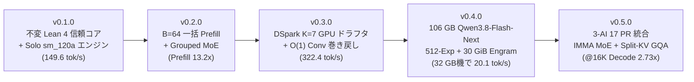

# LeanSonic リリース改善レポート（`v0.1.0` 〜 `v0.4.0` 振り返り）

> 形式検証済み Lean 4 不変信頼コア（`Axioms.lean` は `v0.1.0` 以降 `0` diff で凍結）＋ ゼロ外部依存 Rust（`std` + POSIX `mmap`/`dlopen`）＋ Blackwell `sm_120a` 専用 CUDA/PTX/SASS カーネル群。

| リリース | 日付 | 主要マイルストーン | Lean 4 定理数 | スループット・機能到達点 |
| :--- | :--- | :--- | ---: | :--- |
| **`v0.1.0`** | 2026-11-26 | Phase 0 & 1 不変信頼コア ＋ ループ型 MoE（`Inkling-2-Mini` 48 訪問）＋ OpenAI `serve` & `-p` | `37` (`0 sorry`) | 初の `sm_120a` 完全 GPU 実行 `Inkling-2-Mini` エンジン：`128.3 tok/s`（`PRO 4500`）・`149.6 tok/s`（`PRO 5000`）、全カーネル `STACK: 0`、5段階自律 CI パイプライン（`Gates 0–4`）確立。 |
| **`v0.2.0`** | 2026-11-26 | Cycle 1 マルチトークン一括 Prefill（`B = 64`）＋ ゼロアトミック Grouped MoE | `44` (`0 sorry`) | 1トークン逐次 Prefill を `16×8` Planar `Q8_64` GEMM ＋ Tile-8 Grouped `NVFP4`/`MXFP8` MoE ＋ レジスタ常駐 `short_conv4_b` に刷新：**Prefill `13.2×` 高速化**（`PRO 5000` で `74 → 997 tok/s`）、Solo == Batch **`0.0000-ULP`** 完全一致。 |
| **`v0.3.0`** | 2026-11-26 | Cycle 2 `DSpark`（`mtp.safetensors`）GPU 投機ドラフタ ＋ `O(1)` Conv 巻き戻し | `51` (`0 sorry`) | 完全 GPU 実行 `DSpark`（`K=7`）＋ `ink2_conv_rewind`（`22` regs）：`RTX PRO 4500` で **`252.2 tok/s`**（Solo 比 `1.97×`）、`RTX PRO 5000` で **`322.4 tok/s`**、`--spec 0 == --spec 7` **`0.0000-ULP`** 完全無損失一致。 |
| **`v0.4.0`** | 2026-11-26 | `106 GB` 22シャード `Qwen3.8-Flash-Next`（`512` エキスパート ＋ `29.8 GiB` 128シャード `Engram`） | `61` (`0 sorry`) | 単一 `32 GB` `RTX PRO 4500` 上で `106 GB` モデルを実行（`18/48` 層 VRAM 常駐 ＋ `30/48` 層 Pinned DDR5 ストリーミング ＋ 48層 CUDA Graph）：**`20.1 tok/s`**（物理 PCIe Gen5 x8 線路帯域上限の `69%`、8スレッドロード `10.21 秒`）、`HostPinned == MmapCompact` **`0.0000-ULP`** 完全一致。 |

## リリース別アーキテクチャ進化フロー

