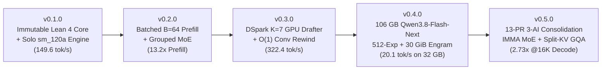

# LeanSonic Release Improvement Reports (`v0.1.0` – `v0.4.0` Retrospective)

> Formal Lean 4 Trust Core (`Axioms.lean` frozen at `0` diff since `v0.1.0`) + Zero-Dependency Rust (`std` + POSIX `mmap`/`dlopen`) + Blackwell `sm_120a` CUDA/PTX/SASS Kernels.

| Release | Date | Primary Milestone | Lean 4 Theorems | Key Throughput / Capability Delta |
| :--- | :--- | :--- | ---: | :--- |
| **`v0.1.0`** | 2026-11-26 | Phase 0 & 1 Immutable Trust Core + Looped MoE (`Inkling-2-Mini` 48 Visits) + OpenAI `serve` & `-p` | `37` (`0 sorry`) | First `sm_120a` full-GPU `Inkling-2-Mini` engine: `128.3 tok/s` (`PRO 4500`), `149.6 tok/s` (`PRO 5000`), `STACK: 0` across all kernels, 5-Gate autonomous CI pipeline (`Gates 0–4`). |
| **`v0.2.0`** | 2026-11-26 | Cycle 1 Multi-Token Batched Prefill (`B = 64`) + Zero-Atomic Grouped MoE | `44` (`0 sorry`) | Replaced token-by-token prefill with `16×8` Planar `Q8_64` GEMM + Tile-8 Grouped `NVFP4`/`MXFP8` MoE + Register-Persistent `short_conv4_b`: **`13.2×` faster prefill** (`74 -> 997 tok/s` on `PRO 5000`), `0.0000-ULP` Solo == Batch parity. |
| **`v0.3.0`** | 2026-11-26 | Cycle 2 `DSpark` (`mtp.safetensors`) GPU Speculative Drafter + `O(1)` Conv Rewind | `51` (`0 sorry`) | Full-GPU `DSpark` (`K=7`) + `ink2_conv_rewind` (`22` regs): **`252.2 tok/s`** on `RTX PRO 4500` (`1.97×` Solo) and **`322.4 tok/s`** on `RTX PRO 5000`, `0.0000-ULP` lossless `--spec 0 == --spec 7`. |
| **`v0.4.0`** | 2026-11-26 | `106 GB` 22-Shard `Qwen3.8-Flash-Next` (`512` Experts + `29.8 GiB` 128-Shard `Engram`) | `61` (`0 sorry`) | Runs `106 GB` `Qwen4Exp` on a single `32 GB` `RTX PRO 4500` (`18/48` VRAM + `30/48` Pinned DDR5 + 48-layer CUDA Graph): **`20.1 tok/s`** (`69%` physical PCIe Gen5 x8 wire ceiling, `10.21s` 8-thread load), `0.0000-ULP` `HostPinned == MmapCompact`. |

## Release-by-Release Architecture Flow

