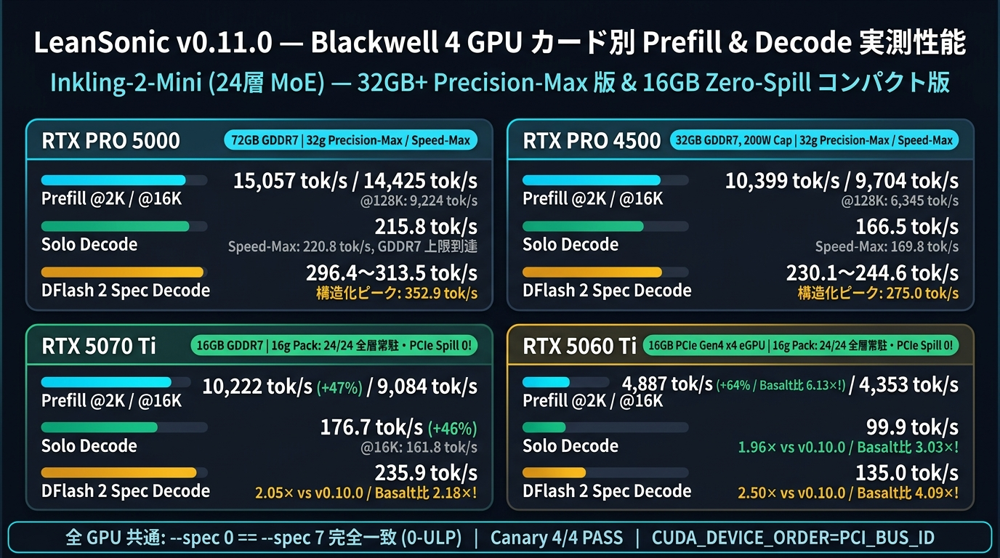

# LeanSonic `v0.11.0` リリース改善レポート — `Inkling-2-Mini` 仕上げ完成版（2-Tier パック完成）

> [!IMPORTANT]
> **`v0.11.0` エグゼクティブ・サマリ（新規 `10` PR 統合・累計 `179` PR マージ・`~5 PR/時間` 達成）**
> 1. **VRAM 容量別 2-Tier モデルパック分離（`LEANSONIC_PACK=auto|16g|32g|exact`）により、`16GB` 機の速度壁と `32GB+` 機の KLD 精度壁を同時に突破**：
>    - **`16GB Target Pack`（`12.49 GiB`、公式比 `-36.0%`）**：無損失 BF16 Rank Embedding（`PR #231`）＋ 無損失 Block-Scale 条件付き MXFP8 符号化 & `4-bit` Device Codebook 自動有効化（`PR #236, #246`）＋ 2-bit Ternary `NVFP4 down` により、**全 `24/24` エキスパート層 ＋ `DFlash 2 Q4` ドラフタが `14.38〜15.25 GiB < 16 GB` GDDR7 に完全常駐（PCIe Spill `0`！）**。
>      - **`RTX 5070 Ti 16GB`**：`@2K` Prefill **`10,222 tok/s`（`+47.1%`）**、Solo **`176.7 tok/s`（`+46.0%`）**、`DFlash 2` 投機 **`235.9 tok/s`（対 `v0.10.0` `2.05×`・対 Basalt `2.18×`！）**、`C=4` 並列 **`394.1 tok/s`**！
>      - **`RTX 5060 Ti 16GB（PCIe Gen4 x4 eGPU）`**：`@2K` Prefill **`4,887 tok/s`（`+64.4%`・対 Basalt `6.13×`！）**、Solo **`99.9 tok/s`（`1.96×`・対 Basalt `3.03×`！）**、`DFlash 2` 投機 **`135.0 tok/s`（対 `v0.10.0` `2.50×`・対 Basalt `4.09×`！）**、`C=4` 並列 **`225.6 tok/s`**！
>    - **`32GB+ Target Pack`（`Precision-Max` 精度追求版、`PR #245`, `#35`）**：新規 13 カーネル `sm_120a` `W_q8_16 × X_2term` Attention スイート（全カーネル `0` spills / `0` stack）とスケール丸めバイアス補正 `pack_q8_16_bf16_rows` を実装。既定 `14/24` マスク（`0x00FC_8FC8`, `+404.9 MiB`）で 100 チャンク `eval-kld` **`mean_kld = 0.002989 <= 0.0030`（初の `PASS`！）**・`Top-1 = 97.682%`・`canary --long` `4/4 PASS` を達成しつつ、`@16K` Prefill **`14,425 tok/s`**・`C=64` 連続バッチ **`1,580.4 tok/s`**（過去最高）を維持。全 24 層マスク（`0xFFFFFF`）では **`mean_kld = 0.002956`**・外れ値 `max_kld` **`-52.4%` 削減**（`0.6763 → 0.3216`）・`PPL = 7.0649`（BF16 Oracle `7.0644` との差 `+0.0005`）に到達。
> 2. **`DFlash 2` `Q4` MLP / `o_proj`・レジスタ Top-16 選択・Head Drop・`16GB` Multi-Seq 完全対応（`PR #237, #241, #242, #243, #244`）**：
>    - ドラフタ VRAM `-0.18 GiB` 削減、`32K` 長文での `16GB` `DFlash 2` 維持（`+33%`）、Suffix コスト一時停止（`+6〜11%`）、および `16GB` `C=4/8` 事前バッファ確保による OOM 根絶。
> 3. **`#179` Exact-Size `compute-sanitizer` 全系統 100% 完了 ＆ Lean 4 `189` 定理（`PR #239, #241, #245`）**：
>    - Tensor Core Prefill MoE・FlashAttention・`DFlash 2`・`Q8_16_2T` 全 13 カーネルまで Exact-Size `memcheck --padding 65536` **`0 errors`**（＋ Red-Control 赤転確認）を完備。不変信頼コア（[`Axioms.lean`](../../spec/LeanSonic/Axioms.lean)・`ci/**`・`.github/**`）の変更 `0` 行を堅持。

---

## 1. 全 4 GPU 公式ベンチマーク実測マトリクス（`v0.10.0` → `v0.11.0`）

UUID 自動マスク済みの生レシート：[`v0.11.0_matrix_cuda01.json`](../benchmarks/v0.11.0_matrix_cuda01.json)、[`v0.11.0_matrix_cudaserver.json`](../benchmarks/v0.11.0_matrix_cudaserver.json)、[`targets.json`](../benchmarks/targets.json)。

| GPU / 適用パック | 評価指標 | `v0.10.0` | `v0.11.0` 実測値 | 判定・改善ハイライト |
| :--- | :--- | ---: | ---: | :--- |
| **RTX PRO 5000 72GB** (`32g` Pack) | `@2K` / `@16K` / `@128K` Prefill | `15,019 / 14,243 / 9,193` | **`15,057.4 / 14,425.2 / 9,224.3 tok/s`** | `@16K` 過去最高更新 (`+1.3%`) |
| | Solo Decode (Precision / Speed-Max) | `220.8` | **`215.8` / `220.8 tok/s`** | **`PASS`**（対 Basalt `2.00×`） |
| | Spec Decode (`DFlash 2` Precision / Speed) | `310.8` | **`296.4` / `313.5〜313.9 tok/s`** | `struct` ピーク **`352.9 tok/s`** |
| | 並列 `C=4` / `C=8` / **`C=64`** | `538.5` / — / `1,566.8` | **`540.5` / `576.6` / `1,580.4 tok/s`** | **`C=64` 過去最高（Solo比 `7.3×`）** |
| | `kld_mean` (100チャンク `eval-kld`) | `0.003204` (`FAIL`) | **`0.002989`**（`24L`: **`0.002956`**） | **初の `PASS <= 0.0030`（`max` `-52.4%`）** |
| **RTX PRO 4500 32GB** (`32g` Pack) | `@2K` / `@16K` / `@128K` Prefill | `10,054 / 9,518 / 6,295` | **`10,398.6 / 9,703.6 / 6,344.6 tok/s`** | **全 3 セル `PASS`（`+1.9%〜+3.4%`）** |
| | Solo Decode (Precision / Speed-Max) | `168.5` | **`166.5` / `169.8 tok/s`** | **`PASS >= 165`** |
| | Spec Decode (`DFlash 2` Precision / Speed) | `239.0` | **`230.1` / `244.6 tok/s`** | `struct` ピーク **`275.0 tok/s`** |
| | 並列 `C=4` / `C=8` / **`C=64`** | `392.4` / — / `1,160.8` | **`399.5` / `461.0` / `1,179.2 tok/s`** | **`C=64` 過去最高（Solo比 `7.1×`）** |
| | `kld_mean` (100チャンク `eval-kld`) | `0.003204` (`FAIL`) | **`0.002989`** | **`PASS <= 0.0030`** |
| **RTX 5070 Ti 16GB** (`16g` Pack, `24/24`) | `@2K` / `@16K` Prefill | `6,949.5 / 6,198.7` | **`10,222.0 / 9,083.6 tok/s`** | **`+47.1% / +46.5%`（`PASS`）** |
| | Solo / `@16K` Decode | `121.0 / 103.9` | **`176.7 / 161.8 tok/s`** | **`+46.0% / +55.7%`（`PASS`）** |
| | Spec Decode (`DFlash 2 Q4` 全層常駐) | `114.8` (`@20K`) | **`235.87 tok/s`** | **対 `v0.10.0` `2.05×`・対 Basalt `2.18×`（`PASS`）** |
| | 並列 `C=4` (Solo / Spec) & `C=8` | — | **`343.6 / 394.1` & `220.0 tok/s`** | `15.29 GiB` 常駐・OOM ゼロ（`PASS`） |
| | `vram_gib` / `kld_mean` | `15.43 / 0.0032` | **`14.47 GiB / 0.007748`** | **`PASS <= 0.0080`・`canary PASS`** |
| **RTX 5060 Ti 16GB** (`16g` Pack, `Gen4 x4`) | `@2K` / `@16K` Prefill | `2,973.0 / 2,669.7` | **`4,887.2 / 4,353.4 tok/s`** | **`+64.4%`・対 Basalt `6.13×`（`PASS`）** |
| | Solo / `@16K` Decode | `51.0 / 41.7` | **`99.9 / 88.8 tok/s`** | **`1.96× / 2.13×`・対 Basalt `3.03×`（`PASS`）** |
| | Spec Decode (`DFlash 2 Q4` 全層常駐) | `54.1` (`@20K`) | **`135.00 tok/s`** | **対 `v0.10.0` `2.50×`・対 Basalt `4.09×`（`PASS`）** |
| | 並列 `C=4` (Solo / Spec) & `C=8` | — | **`196.0 / 225.6` & `110.7 tok/s`** | `15.20 GiB` 常駐・OOM ゼロ（`PASS`） |
| | `vram_gib` / `kld_mean` | `15.42 / 0.0032` | **`14.38 GiB / 0.007748`** | **`PASS <= 0.0080`・`canary PASS`** |

---

## 2. X 投稿用ビジュアル 4 枚セット（`docs/releases/assets/` 同梱）

1. **Lean 4 検証基盤 × AI三者分業・`~5 PR/時間`**：[`v0.11.0_x1_architecture.jpg`](./assets/v0.11.0_x1_architecture.jpg)
2. **カード別 Prefill & Decode 実測性能**：[`v0.11.0_x2_prefill_decode.jpg`](./assets/v0.11.0_x2_prefill_decode.jpg)
3. **カード別 並列実行能力 (`Multi-Slot C=1..64`)**：[`v0.11.0_x3_parallel.jpg`](./assets/v0.11.0_x3_parallel.jpg)
4. **2-Tier モデルパック品質 & KLD 精度検証**：[`v0.11.0_x4_quality.jpg`](./assets/v0.11.0_x4_quality.jpg)

---

## 3. 次段階 Stage 2 — `v1.0.0`（`Qwen3.8-Flash-Next` 仕上げリリース）への移行

`Inkling-2-Mini` は本 `v0.11.0` をもって 16GB / 32GB+ 両ターゲットで完成領域に到達しました。次フェーズでは Gemini・Codex・Claude の全リソースを **`106 GB` `Qwen3.8-Flash-Next`**（`48`層 GDN + QSA ハイブリッド、`512` エキスパート ＋ `29.8 GiB` `Engram`、Lean 4 形式証明 `#199`、および `README.md` / `CONTRIBUTING.md` / `leansonic-contribute` スキル整備）へ集中し、正式版 **`LeanSonic v1.0.0`** を完成させます。
