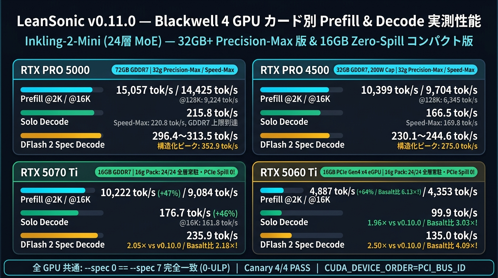

# LeanSonic `v0.11.0` Release Improvement Report — `Inkling-2-Mini` Final Edition

## 1. Executive Summary (`v0.10.0` → `v0.11.0`, `Inkling-2-Mini` Capstone Release)

`LeanSonic v0.11.0` integrates **10 verified Pull Requests** (`#231, #236, #237, #239, #241, #242, #243, #244, #245, #246`, **`179` total merged PRs** in `~43` hours = **`~5 PRs/hour`** sustained with `0` regressions) across **Gemini** (Orchestrator & Kernel Architect), **Codex** (Lossless Compression & Quantization), and **Claude** (Speculative Drafter, Multi-Slot & Sanitizer), completing the **`Inkling-2-Mini` Final Edition (`#235`)** ahead of the Stage 2 `v1.0.0` (`Qwen3.8-Flash-Next`) push:

1. **2-Tier Hardware Model Pack Architecture (`LEANSONIC_PACK=auto|16g|32g|exact`, `PR #231, #236, #241, #245, #246`)**:
   - **`16GB Target Pack` (`12.49 GiB`, `-36.0%` vs `19.53 GB` official)**: Combines lossless BF16 rank embedding (`model.llm.embed.weight.rank_v1`, `PR #231`), lossless block-scale-conditioned MXFP8 expert codes (`.mxscale_codes_v1` + auto `4-bit` device codebook, `PR #236, #246`), and controlled 2-bit ternary `NVFP4 down` projections (`mean_kld = 0.00775` test / `0.00695` valid, `top1 = 96.22%–96.65%`, `canary` `PASS`). Fits **all `24/24` expert layers + `DFlash 2 Q4` co-resident in `14.38–15.25 GiB < 16 GB` GDDR7 (`0` PCIe spill!)**:
     - **`RTX 5070 Ti 16GB`**: `@2K` Prefill **`10,222.0 tok/s` (`+47.1%`)**, `@16K` Prefill **`9,083.6 tok/s` (`+46.5%`)**, Solo Decode **`176.7 tok/s` (`+46.0%`)**, `@16K` Decode **`161.8 tok/s` (`+55.7%`)**, `DFlash 2` Speculative **`235.87 tok/s` (`2.05×` `v0.10.0` `@20K`, `2.18×` Basalt `108`)**, and `C = 4` Parallel **`394.1 tok/s`** (`24/24` resident)!
     - **`RTX 5060 Ti 16GB (PCIe Gen4 x4 OCuLink eGPU)`**: `@2K` Prefill **`4,887.2 tok/s` (`+64.4%`, `6.13×` Basalt `797`)**, `@16K` Prefill **`4,353.4 tok/s` (`+63.1%`)**, Solo Decode **`99.9 tok/s` (`1.96×` `v0.10.0`, `3.03×` Basalt `33`)**, `@16K` Decode **`88.8 tok/s` (`2.13×`)**, `DFlash 2` Speculative **`135.0 tok/s` (`2.50×` `v0.10.0`, `4.09×` Basalt `33`)**, and `C = 4` Parallel **`225.6 tok/s`** (`24/24` resident)!
   - **`32GB+ Target Pack` (`Precision-Max`, `PR #245`, `#35`)**: Adds a 13-kernel `sm_120a` `W_q8_16 × X_2term` (`Q8_16_2T`) attention suite (`0` spills / `0` stack) with scale-bias-compensated `pack_q8_16_bf16_rows`. Default `14/24` Pareto mask (`0x00FC_8FC8`, `+404.9 MiB`) clears the 100-chunk `eval-kld` gate at **`mean_kld = 0.002989 <= 0.0030`** (`p99 = 0.02965`, `top1 = 97.682%`, `canary --long` `4/4 PASS`) while sustaining **`215.8 tok/s`** Solo (`PRO 5000`) / **`166.5 tok/s`** Solo (`PRO 4500`), **`14,425.2 tok/s`** `@16K` Prefill, and **`1,580.4 tok/s`** `C = 64` continuous batching (`PRO 5000`). Full `24/24` mask (`0x00FF_FFFF`) reaches **`mean_kld = 0.002956`** (`PPL = 7.0649` vs BF16 Oracle `7.0644`, `max_kld` `-52.4%`: `0.6763 → 0.3216`); Speed-Max (`LEANSONIC_ATTN_Q8_16=0`) delivers **`220.8 tok/s`** Solo and **`313.5–313.9 tok/s`** `DFlash 2` Speculative (`struct` peak **`352.9 tok/s`**).

2. **`DFlash 2` `Q4` MLP / `o_proj`, Register Top-16 Selector, Head Drop & `16GB` Multi-Seq (`PR #237, #241, #242, #243, #244`)**:
   - **`Q4` `DFlash 2` MLP & `o_proj` (`PR #237, #241`)**: Shrinks drafter VRAM by `-0.18 GiB` and lifts Speed-Max `spec_avg` to **`313.9 tok/s`** on `RTX PRO 5000`.
   - **Graceful `Q4` Draft Head Drop (`PR #242`) & Suffix Cost-Pause (`PR #243`)**: Keeps `DFlash 2` active on `16 GB` GPUs at `32K` context (`+33%` over Suffix fallback) and accelerates standalone Suffix rounds by `+6–11%`.
   - **Eager Multi-Seq Conv Buffer Allocation (`PR #244`)**: Eliminates lazy `cuMemAlloc` OOM on `16 GB` `C = 4 / C = 8` `multiseq` and `serve`.

3. **100% `#179` Exact-Size `compute-sanitizer` Completion & `189` Lean 4 Theorems (`PR #239, #241, #245`)**:
   - Extends unpadded exact-size `compute-sanitizer --tool memcheck --padding 65536` harnesses + planted-fault red controls across Tensor Core Prefill MoE, FlashAttention (`PR #239`), `DFlash 2` (`PR #241`), and all 13 `Q8_16_2T` kernels (`PR #245`) — **`0` errors** across the entire engine.
   - Expands formal proofs to **`189` Lean 4 theorems** (`0 sorry`, `0 custom axiom`) with **`0` diff** on Immutable Trust Core (`Axioms.lean`, `ci/**`, `.github/**`, `CODEOWNERS`, `benches/goldens/**`).

---

## 2. 4-GPU Verified Performance Matrix (`v0.10.0` → `v0.11.0`, `CUDA_DEVICE_ORDER=PCI_BUS_ID`)

Raw redacted receipts: [`v0.11.0_matrix_cuda01.json`](../benchmarks/v0.11.0_matrix_cuda01.json), [`v0.11.0_matrix_cudaserver.json`](../benchmarks/v0.11.0_matrix_cudaserver.json), [`targets.json`](../benchmarks/targets.json).

| GPU / Tier | Metric | `v0.10.0` | `v0.11.0` Measured | Gain / Notes |
| :--- | :--- | ---: | ---: | :--- |
| **RTX PRO 5000 72GB** (`32g` Pack) | `prefill_2k` / `prefill_16k` / `prefill_128k` | `15,019` / `14,243` / `9,193` | **`15,057.4`** / **`14,425.2`** / **`9,224.3 tok/s`** | `@16K` new high (`+1.3%`) |
| | `decode_short` (Precision-Max / Speed-Max) | `220.8` | **`215.8`** / **`220.8 tok/s`** | `PASS` (`2.00×` Basalt) |
| | `spec_avg` (`DFlash 2` Precision / Speed-Max) | `310.8` | **`296.4`** / **`313.5–313.9 tok/s`** | `struct` peak **`352.9 tok/s`** |
| | `c4_32k_code` / `c64_total` | `538.5` / `1,566.8` | **`540.5`** / **`1,580.4 tok/s`** | `C=4` solo `427.1`, `C=8` `576.6` |
| | `kld_mean` (100-chunk `eval-kld`) | `0.003204` (`FAIL`) | **`0.002989`** (`24L`: **`0.002956`**) | **`PASS <= 0.0030` (`max_kld` `-52.4%`)** |
| **RTX PRO 4500 32GB** (`32g` Pack) | `prefill_2k` / `prefill_16k` / `prefill_128k` | `10,054` / `9,518` / `6,295` | **`10,398.6`** / **`9,703.6`** / **`6,344.6 tok/s`** | **All 3 `PASS` (`+1.9%..+3.4%`)** |
| | `decode_short` (Precision-Max / Speed-Max) | `168.5` | **`166.5`** / **`169.8 tok/s`** | **`PASS >= 165`** |
| | `spec_avg` (`DFlash 2` Precision / Speed-Max) | `239.0` | **`230.1`** / **`244.6 tok/s`** | `struct` peak **`275.0 tok/s`** |
| | `c4_32k_code` / `c64_total` | `392.4` / `1,160.8` | **`399.5`** / **`1,179.2 tok/s`** | `C=4` solo `337.7`, `C=8` `461.0` |
| | `kld_mean` (100-chunk `eval-kld`) | `0.003204` (`FAIL`) | **`0.002989`** | **`PASS <= 0.0030`** |
| **RTX 5070 Ti 16GB** (`16g` Pack, `24/24`) | `prefill_2k` / `prefill_16k` | `6,949.5` / `6,198.7` | **`10,222.0`** / **`9,083.6 tok/s`** | **`+47.1%` / `+46.5%` (`PASS`)** |
| | `decode_short` / `decode_16k` | `121.0` / `103.9` | **`176.7`** / **`161.8 tok/s`** | **`+46.0%` / `+55.7%` (`PASS`)** |
| | `spec_avg` (`DFlash 2 Q4`, `24/24` Resident) | `114.8` (`@20K`) | **`235.87 tok/s`** | **`2.05×` `v0.10.0` / `2.18×` Basalt (`PASS`)** |
| | Parallel `C=4` (Solo / Spec) & `C=8` | — | **`343.6 / 394.1`** & **`220.0 tok/s`** | `15.29 GiB`, `0` OOM (`PASS`) |
| | `vram_gib` / `kld_mean` | `15.43` / `0.0032` | **`14.47 GiB`** / **`0.007748`** | **`PASS <= 0.0080`, `canary PASS`** |
| **RTX 5060 Ti 16GB** (`16g` Pack, `Gen4 x4`) | `prefill_2k` / `prefill_16k` | `2,973.0` / `2,669.7` | **`4,887.2`** / **`4,353.4 tok/s`** | **`+64.4%` (`6.13×` Basalt, `PASS`)** |
| | `decode_short` / `decode_16k` | `51.0` / `41.7` | **`99.9`** / **`88.8 tok/s`** | **`1.96×` / `2.13×` (`3.03×` Basalt, `PASS`)** |
| | `spec_avg` (`DFlash 2 Q4`, `24/24` Resident) | `54.1` (`@20K`) | **`135.00 tok/s`** | **`2.50×` `v0.10.0` / `4.09×` Basalt (`PASS`)** |
| | Parallel `C=4` (Solo / Spec) & `C=8` | — | **`196.0 / 225.6`** & **`110.7 tok/s`** | `15.20 GiB`, `0` OOM (`PASS`) |
| | `vram_gib` / `kld_mean` | `15.42` / `0.0032` | **`14.38 GiB`** / **`0.007748`** | **`PASS <= 0.0080`, `canary PASS`** |

---

## 3. X Visual Gallery (`v0.11.0`)

- **Architecture & 3-AI Velocity (`~5 PRs/hour`)**: [`v0.11.0_x1_architecture.jpg`](./assets/v0.11.0_x1_architecture.jpg)
- **Per-GPU Prefill & Decode**: [`v0.11.0_x2_prefill_decode.jpg`](./assets/v0.11.0_x2_prefill_decode.jpg)
- **Per-GPU Multi-Slot Parallel Scaling (`C=1..64`)**: [`v0.11.0_x3_parallel.jpg`](./assets/v0.11.0_x3_parallel.jpg)
- **2-Tier Pack Quality & KLD Verification**: [`v0.11.0_x4_quality.jpg`](./assets/v0.11.0_x4_quality.jpg)
