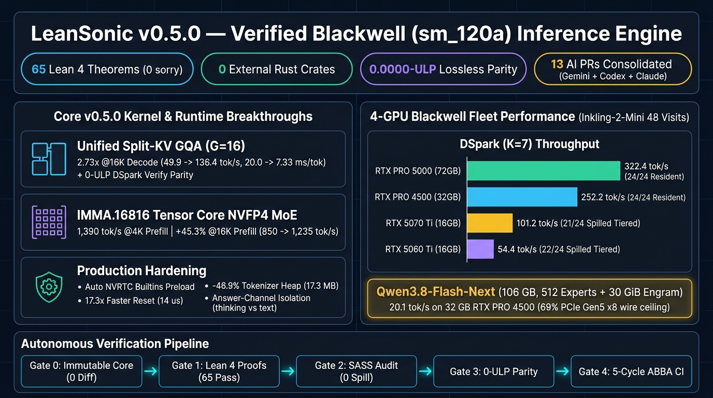
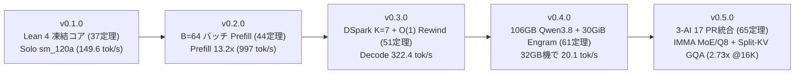

# LeanSonic `v0.5.0` 改善レポート & インフォグラフィック

> [!IMPORTANT]
> **Immutable Trust Core 完全維持 (`0` Diff from `v0.1.0`)**: [Axioms.lean](../../spec/LeanSonic/Axioms.lean)・`ci/**`・`.github/**`・`CODEOWNERS`・`benches/goldens/**` を1行も変更せず、**3 AI（Gemini オーケストレータ + Codex + Claude）の計17 PR統合**と **65個のLean 4定理（`0 sorry`, `0 axiom`）** により `v0.5.0` を達成しました。

---

## 1. `v0.4.0` → `v0.5.0` の主要改善ハイライト

1. **Unified Split-KV + GQA-Grouped Attention（`PR #9` 完成 + `DSpark` `0.0000-ULP` パリティ、`PR #37`）**
   - [inkling2_sm120.cu](../../kernels/inkling2_sm120.cu) の `ink2_gqa_attn_split`（`Grid (8 * B, G)`, `56` regs, `14,976` B SMEM → **`64 KiB` L1 維持**）と `ink2_gqa_attn_combine`（`Grid (24, B)`, `39` regs → **`112 KiB` L1 維持**）を `B = 1`（CUDA Graph Solo Decode）および `1 <= B <= 64`（`DSpark` 投機検証・Prefill）で完全共通化。
   - **`@16K` Decode**: `RTX PRO 5000 72GB` で **`49.9 → 136.4 tok/s`（`2.73×` 高速化、`20.03 → 7.33 ms/tok`）**。
   - **投機検証の完全無損失性（`0.0000-ULP`）**: `LEANSONIC_ATTN_SPLIT=16` 有効時、`--spec 0` と `--spec 7`（`DSpark` 棄却巻き戻し発生時を含む）で **`64/64` トークン完全一致・`sum_logits = 911587.3125` 完全一致** を実機確認。
   - **Gate 4（`@4K` 5サイクル非競合ABBA）**: `413.45 → 218.63 ms`（**`-47.12%`**、`95% CI [-47.09%, -47.15%]`）。

2. **ビット完全一致 INT8 Tensor Core（`IMMA.16816.S8.S8`）Prefill 最適化（`#17, #27, #30, #32, #34`）**
   - Grouped `NVFP4` MoE Up+SITU / Down（`PR #32`）および Batched Dense `Q8_64` GEMM（`PR #34`, `4,096` B SMEM → **`96 KiB` L1**）を `mma.sync.aligned.m16n8k16.row.col.s32.s8.s8.s32` へ移行し、既存の `__dp4a` 縮約木と **`0.0000-ULP` 完全一致** を維持。
   - `RTX PRO 5000` における `1,024` tok Prefill は `1,027.07 → 786.87 ms`（**`-23.4%`**）、Split-KV 併用時の `@4K` Prefill は **`1,389.6 tok/s`**、`@16K` Prefill は **`850 → 1,235.2 tok/s`（`+45.3%`）** に到達。

3. **4 GPU 配置最適化・省メモリ・高速リセット（`#7, #16, #26, #29, #31`）**
   - 固定バッファ確保後の実空きVRAMに基づく層・単一行列配置（`PR #26`, Close `#23`）により、`16 GB` 機（`RTX 5070 Ti` / `RTX 5060 Ti`）での `DSpark (K=7)` + CUDA Graph OOM を根絶。
   - 短文 SWA KV 上限化（`-280 MiB` VRAM, `#16`）、`TiktokenBpe` 連続アリーナ化（ホストRAM `-46.9%`: `32.66 → 17.34 MB`, `#7`）、単一 `cuMemsetD8` による履歴リセット（`246.95 → 14.29 µs` = **`17.3×`**, `#29`）、画像タワー分離ツール（`-636.6 MB`, `#31`）。

4. **本番堅牢性・評価オラクル・Answer-Channel 契約（`#15, #18, #20, #22, #24, #25, #33, #36`）**
   - [cuda_ffi.rs](../../crates/leansonic-core/src/cuda_ffi.rs): CUDA Toolkit 非導入ホスト（`cudaserver`）でも `libnvrtc-builtins.so.13.0` を `RTLD_GLOBAL` 自動プリロード（Close `#15`）。Release にビルド済み `sm_120a` `.cubin` も同梱。
   - [serving.rs](../../crates/leansonic-core/src/serving.rs): `10s` ソケット読込タイムアウト・`16 KiB` ヘッダ上限（`431`）・厳格 `Content-Length` 検証（`400`）を追加（Close `#15`）。
   - [main.rs](../../crates/leansonic-cli/src/main.rs): `InklingChannelDecoder` / `QwenChannelDecoder` により推論途中の `thinking` トークンが `"text"` に漏洩する問題を解消し、`"reasoning_content"`・`"finish_reason"`・`"answer_complete"` を明示出力（Close `#25`）。
   - `leansonic eval-kld`（100チャンク教師強制KLD、`#18`）、`inkling_needle`（1K〜128K検索検証、`#24`, Close `#13`）、および 4 GPU 共通ロック付き `leansonic bench-matrix`（`#36`）を統合。

---

## 2. 4 GPU Blackwell (`sm_120a`) 実測サマリ (`v0.5.0`)

| GPU (`PCI_BUS_ID`) | 常駐層 (`Inkling-2-Mini`) | Prefill (`tok/s`) | Solo Decode (`tok/s`) | `DSpark (K=7)` (`tok/s`) | 検証ハイライト |
| :--- | :--- | ---: | ---: | ---: | :--- |
| **RTX PRO 5000 (72 GB)** | `24 / 24` VRAM | **`1,389.6`** (`@4K`) | `146.8` (`@4K`) / `136.4` (`@16K`) | **`322.4`** (`3.10 ms/tok`) | `@16K` Decode `2.73×`, `0-ULP` Solo == Verify |
| **RTX PRO 4500 (32 GB)** | `24 / 24` VRAM | `988.1` (`chat`) | `128.7` | **`252.2`** (`3.97 ms/tok`) | `Qwen3.8-Flash-Next` (`106 GB`) **`20.1 tok/s`** |
| **RTX 5070 Ti (16 GB)** | `21–22 / 24` Mixed | `372.7` (`@1K`) | `52.5` (`@1K`) | **`101.2`** (`9.88 ms/tok`) | 既存常駐プロセス共存下で安定稼働 (`#26`) |
| **RTX 5060 Ti (16 GB)** | `22 / 24` Mixed | `224.5` (`@1K`) | `35.3` (`@1K`) | **`54.4`** (`18.39 ms/tok`) | 環境変数設定なしで NVRTC 自動解決 (`#15`) |

---

## 3. リリース履歴推移（`v0.1.0` → `v0.5.0`）

