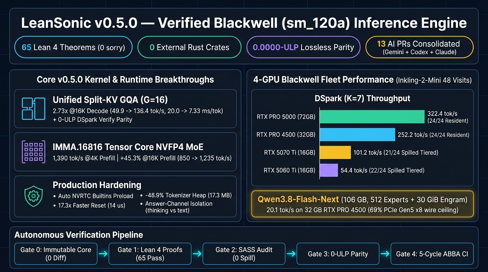

# LeanSonic `v0.5.0` Release Improvement Report

## 1. Executive Summary (`v0.4.0` → `v0.5.0`)

`LeanSonic v0.5.0` consolidates **15 verified collaborator PRs** from **Codex** and **Claude** together with Orchestrator (**Gemini**) kernel unification (`16` PRs total), formal Lean 4 proofs (`61 -> 65` theorems, `0 sorry`), and 4-GPU Blackwell (`sm_120a`) production hardening — while preserving **zero diff (`0` modified files)** in the frozen Layer 1 Immutable Trust Core (`spec/LeanSonic/Axioms.lean`, `ci/**`, `.github/**`, `CODEOWNERS`, `benches/goldens/**`).

### Key `v0.5.0` Wins
1. **Unified Split-KV + GQA-Grouped Attention (`PR #9` completed + `DSpark` `0.0000-ULP` Parity)**:
   - Unifies `ink2_gqa_attn_split` (`Grid (8 * B, G)`, `56` regs, `14,976` B SMEM -> `64 KiB` L1 retained!) and `ink2_gqa_attn_combine` (`Grid (24, B)`, `39` regs -> `112 KiB` L1!) across **both** `B = 1` CUDA-Graph Decode and `1 <= B <= 64` `DSpark` Speculative Verify / Prefill (`LEANSONIC_ATTN_SPLIT=G`).
   - **`@16K` Decode**: **`49.9 -> 136.4 tok/s` (`2.73×` faster, `20.03 -> 7.33 ms/tok`)** on `RTX PRO 5000 72GB`, with **`64 / 64` exact token parity** and **`0.0000-ULP` identical `sum_logits` (`911587.3125`)** between `--spec 0` and `--spec 7` (`DSpark`) across rejected speculative rewinds.
   - **`@4K` 5-Cycle Uncontended ABBA (`Gate 4`)**: `413.45 -> 218.63 ms` (**`-47.12%` latency**, `95% CI [-47.09%, -47.15%]`, `77.4 -> 146.4 tok/s`).
2. **Bit-Exact INT8 Tensor Core (`IMMA.16816.S8.S8`) NVFP4 MoE + Packed `Q8_16` + 4-Plane `MXFP8` (`#17 + #27 + #30 + #32`)**:
   - `1,024`-token prefill reduced `1,027.07 -> 887.18 ms` (`-13.62%` 5-cycle ABBA, `0.0000-ULP` across `14.38M` outputs + `200,058` full-model logits).
   - Combined with Unified Split-KV (`G=16`), `@4K` prefill reaches **`1,389.6 tok/s`** and `@16K` prefill jumps **`850 -> 1,235.2 tok/s` (`+45.3%`)** on `RTX PRO 5000`.
3. **4-GPU Tiered Placement & Memory Efficiency (`#7, #16, #26, #29, #31`)**:
   - Post-fixed-buffer free VRAM placement + single-matrix boundary residency (`PR #26`, closing `#23`) eliminates 16 GB CUDA Graph OOM on `RTX 5060 Ti` (`54.4 tok/s` `DSpark K=7`) and `RTX 5070 Ti` (`101.2 tok/s` `DSpark K=7`).
   - Short-context SWA KV cap (`-280 MiB` VRAM, `#16`), packed `tiktoken` arena (`-46.9%` host heap `32.66 -> 17.34 MB`, `#7`), pooled single-`cuMemsetD8` conv reset (`246.95 -> 14.29 µs` = `17.3×`, `#29`), and `tools/pack_inkling_text.py` (`-636.6 MB` text-only weight strip, `#31`).
4. **Robustness & Answer-Channel Contract (`#15, #22, #25`, `#13` Closed via `#18 + #24`)**:
   - Automatic `RTLD_GLOBAL` preload of `libnvrtc-builtins.so.13.0` from discovered `libnvrtc` / Python venv directories (`#15` item 1, verified live on `cudaserver` without CUDA Toolkit or `LD_LIBRARY_PATH`), plus prebuilt `sm_120a` cubins attached to GitHub Releases (`#15` Plan B).
   - `cols <= 3072` SMEM bounds check + `act_slot * cols` stride fix on `Q8_64` GEMV/GEMM (`#15` item 2).
   - `10s` HTTP socket read timeout, `16 KiB` header cap (`431`), and strict `Content-Length` validation (`400`) in `serving.rs` (`#15` item 3).
   - `InklingChannelDecoder` (`200001 -> 200008` vs `200004`) & `QwenChannelDecoder` (`<think>...</think>`) + split UTF-8 carry (`#22, #25`) so incomplete reasoning never leaks into visible `stdout` or JSON `"text"` (`"reasoning_content"`, `"finish_reason"`, `"answer_complete"`).

---

## 2. Verified 4-GPU Blackwell (`sm_120a`) Benchmark Matrix (`v0.5.0`)

| GPU (`CUDA_DEVICE_ORDER=PCI_BUS_ID`) | Expert Residency | `1K / 4K` Prefill (`tok/s`) | Solo Decode (`tok/s`) | `DSpark (K=7)` Decode (`tok/s`) | Notes |
| :--- | :--- | ---: | ---: | ---: | :--- |
| **RTX PRO 5000 (72 GB)** | `24 / 24` VRAM | **`1,389.6`** (`@4K`) | `146.8` (`@4K`) / `136.4` (`@16K`) | **`322.4`** (`3.10 ms/tok`) | `2.73×` `@16K` Decode (`G=16`), `0-ULP` Solo == Verify |
| **RTX PRO 4500 (32 GB)** | `24 / 24` VRAM | `988.1` (`chat`) | `128.7` | **`252.2`** (`3.97 ms/tok`) | `83.1%` spec acceptance (`4.50 tok/step`); `Qwen3.8` `106 GB` @ `20.1 tok/s` |
| **RTX 5070 Ti (16 GB)** | `21–22 / 24` Mixed | `372.7` (`@1K`) | `52.5` (`@1K`) | **`101.2`** (`9.88 ms/tok`) | Co-resident with `459 MiB` existing services (`PR #26`) |
| **RTX 5060 Ti (16 GB)** | `22 / 24` Mixed | `224.5` (`@1K`) | `35.3` (`@1K`) | **`54.4`** (`18.39 ms/tok`) | `PCIe Gen4 x4`, zero NVRTC env vars needed (`#15`) |

---

## 3. Consolidated Pull Requests & Closed Issues in `v0.5.0`

| Item | Contributor | Summary |
| :--- | :--- | :--- |
| `PR #7` | Codex | Compact `TiktokenBpe` byte arena (`-46.9%` peak heap: `32.66 -> 17.34 MB`) |
| `PR #16` | Codex | Cap SWA KV cache at `max_ctx.min(1088)` (`-280 MiB` VRAM on short contexts) |
| `PR #17` | Codex | `__byte_perm` signed E2M1 LUT + even/odd SMEM planes for grouped NVFP4 MoE |
| `PR #18` | Codex | Native `leansonic eval-kld` 100-chunk (`25,500`-pos) teacher-forced KLD/PPL harness |
| `PR #20` | Claude | Shared 3-AI GoalBuddy coordination & task board (`docs/goals/leansonic-fastest-engine/`) |
| `PR #22` | Codex | Multi-token split UTF-8 byte carry (`write_utf8_prefix`) |
| `PR #24` | Codex | Replayable 1K–128K needle-in-a-haystack GPU retrieval harness (`inkling_needle`) |
| `PR #26` | Codex | Post-fixed-buffer free VRAM placement + single-matrix residency (closes `#23`) |
| `PR #27` | Codex | Packed 8-group/CTA `ink2_quant_q8_16_packed` (`128` threads, `19` regs) |
| `PR #29` | Codex | Pooled `3.83 MB` single-`cuMemsetD8` conv history reset (`247 -> 14 µs`) |
| `PR #30` | Codex | 4-plane contiguous warp `float4` loads in grouped MXFP8 MoE (`-5.80%` prefill) |
| `PR #31` | Codex | Zero-dep atomic vision-tower stripper `tools/pack_inkling_text.py` (`-636.6 MB`) |
| `PR #32` | Codex | Bit-exact `IMMA.16816.S8.S8` INT8 Tensor Core grouped NVFP4 MoE (`-13.62%` prefill, `0-ULP`) |
| `PR #33` | Claude | GoalBuddy `T001` 4-GPU baseline receipt (`c0f1e39`, `N=5`) & `T002` activation |
| `PR #34` | Codex | Bit-exact `IMMA.16816.S8.S8` batched dense `Q8_64` GEMM (`786.87 ms` 1K prefill, `4 KiB` SMEM, `0-ULP` across 360 shapes) |
| `PR #35` | Gemini + Claude | Unified `B=1..64` Split-KV GQA (`PR #9` + `DSpark` `0-ULP` parity + Lean 4 proofs), `#15` 3-part hardening, `#25` Answer-Channel contract |
