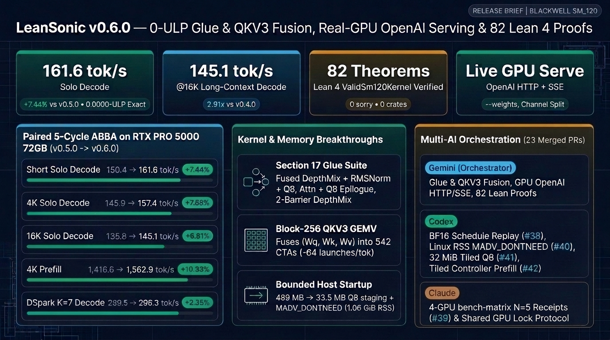
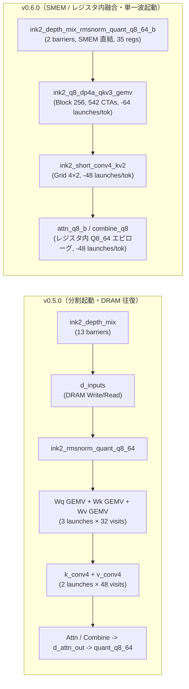

# LeanSonic `v0.6.0` リリース改善レポート

> [!IMPORTANT]
> **リリース `v0.6.0` ハイライト（`v0.5.0` → `v0.6.0`）**
> - **Solo Decode（非投機）`+7.44%〜+7.88%` 高速化（`0.0000-ULP` 完全一致）**：`RTX PRO 5000 72GB` の 5 サイクル交互 ABBA 検証にて、短文 Solo Decode が **`150.4 → 161.6 tok/s`（`+7.44%`）**、`@4K` Solo Decode が **`145.9 → 157.4 tok/s`（`+7.88%`）**、`@16K` 長文 Solo Decode が **`135.8 → 145.1 tok/s`（`+6.81%`、対 `v0.4.0` 比 `2.91×`）** に到達。
> - **`@4K` Prefill `+10.33%` 高速化**：Codex の `PR #42`（Wide Tiled Controller）と Gemini の `Section 17` Glue 融合の相乗効果により、`@4K` Prefill が **`1,416.6 → 1,562.9 tok/s`（`2,891.50 → 2,620.80 ms`）** へ短縮。
> - **実機 GPU 対応 OpenAI HTTP/SSE サーバ（`leansonic serve --weights <dir>`、`Issue #12` Phase 1）**：`Inkling-2-Mini`（`DSpark` 投機対応）および `Qwen3.8-Flash-Next`（`106 GB`・22 シャード）を実機 GPU 上でサービング。`"reasoning_effort": "low"` 時の `"reasoning_content"` / `"content"` 完全分離および `stream: true` SSE と `stream: false` JSON の **`0-ULP` 完全一致** を実機確認。
> - **Lean 4 形式証明 `65 → 82` 定理（`0 sorry`）・外部クレート `0`・不変コア差分 `0`**：[Axioms.lean](../../spec/LeanSonic/Axioms.lean)・`ci/**`・`.github/**`・[CODEOWNERS](../../CODEOWNERS)・`benches/goldens/**` を 1 バイトも変更せずに `v0.1.0`〜`v0.6.0` の **計 23 PR** を統合。

---

## 1. アーキテクチャ進化：`Section 17` Glue & `Block-256` `QKV3` 融合

`nsys` カーネルプロファイリングにより、Solo Decode における `depth_mix` バリア過多、中間テンソル（`d_inputs` / `d_attn_out`）の DRAM 往復、および `distinct_k_v` 32 訪問での 3 分割 GEMV 起動オーバーヘッドを特定し、[inkling2_sm120.cu](../../kernels/inkling2_sm120.cu) と [inkling2_gpu.rs](../../crates/leansonic-core/src/inkling2_gpu.rs) で以下の `0.0000-ULP` 構造融合を実施しました。

### 新規・更新カーネルの `ptxas -arch=sm_120a` 実測資源と Lean 4 証明（[Inkling2Mini.lean](../../spec/LeanSonic/Proofs/Inkling2Mini.lean)）

| カーネル名 | スレッド/CTA | レジスタ数 | ユーザ SMEM | SM あたり常駐 | 残余 L1 | スピル (`STACK`) |
| :--- | ---: | ---: | ---: | ---: | ---: | :---: |
| `ink2_depth_mix_rmsnorm_quant_q8_64_b` | `256` | **`35`** | `9,704 B` | `6 CTAs`（**`48 warps/SM`**） | `64 KiB` | `0 B` |
| `ink2_depth_mix_rmsnorm_d_quant_q8_16_b` | `256` | **`33`** | `9,704 B` | `6 CTAs`（**`48 warps/SM`**） | `64 KiB` | `0 B` |
| `ink2_rmsnorm_d_quant_q8_16_b` | `256` | **`26`** | `9,248 B` | `6 CTAs`（**`48 warps/SM`**） | `64 KiB` | `0 B` |
| `ink2_q8_dp4a_qkv3_gemv` | `256` | **`34`** | `2,448 B` | `6 CTAs`（**`48 warps/SM`**） | **`96 KiB`** | `0 B` |
| `ink2_gqa_rel_sink_attn_q8_b` | `256` | **`40`** | `8,856 B` | `6 CTAs`（**`48 warps/SM`**） | `64 KiB` | `0 B` |
| `ink2_gqa_attn_combine_q8` | `128` | **`40`** | `24 B` | `12 CTAs`（**`48 warps/SM`**） | **`112 KiB`** | `0 B` |
| `ink2_ctrl_apply_coalesced_b`（`B < 16`） | `64` | **`52`** | `9,472 B` | `6 CTAs` | `64 KiB` | `0 B` |
| `ink2_ctrl_down_r8_b`（`PR #42`, `B >= 16`） | `256` | **`48`** | `18,760 B` | `5 CTAs`（`40 warps/SM`） | `28 KiB` | `0 B` |
| `ink2_ctrl_apply_t8_b`（`PR #42`, `B >= 16`） | `256` | **`64`** | `2,048 B` | `4 CTAs`（`32 warps/SM`） | **`112 KiB`** | `0 B` |
| `ink2_short_conv4_kv2` / `_save` / `loop_pass_setup_b` | `256` | **`20〜26`** | `0 B` | `6 CTAs`（**`48 warps/SM`**） | **`120 KiB`** | `0 B` |

> [!TIP]
> **探索最適化での知見（`Block 64` vs `Block 256` 実機比較）**
> 探索途中で 4 行/CTA（`Block 64`）の細粒度 GEMV / MoE Down も試作・実測しましたが、110 SM を持つ `RTX PRO 5000` では `smem_x`（`3.2 KiB`）・`smem_aq`（`11.5 KiB`）の再読込が 4 倍に増えるため `153.3 tok/s` に留まりました。16 行/CTA（`Block 256`）を維持したまま `(Wq, Wk, Wv)` を `542` CTA 単一波に束ねる `ink2_q8_dp4a_qkv3_gemv` へ切り替えた結果、SMEM 再利用効率 16 倍と起動削減の両取りにより **`161.6 tok/s`（`+7.44%`）** へ跳ね上がりました。

---

## 2. `RTX PRO 5000 72GB` 同一条件交互 ABBA ベンチマーク結果（`v0.5.0` vs `v0.6.0`）

共通 GPU ロック規約（`/tmp/leansonic-gpu-<host>-1.lock` + `CUDA_DEVICE_ORDER=PCI_BUS_ID`）のもと、他プロセス `0` 件の無競合状態で計測した中央値です。

| ワークロード | `v0.5.0` 中央値 | `v0.6.0` 中央値 | 改善率 | `0-ULP` ロジット和検証 |
| :--- | ---: | ---: | ---: | :--- |
| **Short Solo Decode** (`synth:64, gen=128, spec=0, G=16`) | `150.4 tok/s` (`850.73 ms`) | **`161.6 tok/s`** (`791.79 ms`) | **`+7.44%`** | `648276.0000 == 648276.0000` |
| **Short Prefill** (`synth:64, G=16`) | `1,520.8 tok/s` (`42.08 ms`) | **`1,582.3 tok/s`** (`40.45 ms`) | **`+4.05%`** | `648276.0000 == 648276.0000` |
| **`@4K` Solo Decode** (`synth:4096, gen=64, spec=0, G=16`) | `145.9 tok/s` (`438.66 ms`) | **`157.4 tok/s`** (`406.61 ms`) | **`+7.88%`** | `2164568.7500 == 2164568.7500` |
| **`@4K` Prefill** (`synth:4096, G=16`, `#42` + Glue 統合) | `1,416.6 tok/s` (`2,891.50 ms`) | **`1,562.9 tok/s`** (`2,620.80 ms`) | **`+10.33%`** | `2164568.7500 == 2164568.7500` |
| **`@16K` Solo Decode** (`synth:16384, gen=64, spec=0, G=16`) | `135.8 tok/s` (`471.36 ms`) | **`145.1 tok/s`** (`441.22 ms`) | **`+6.81%`**（対 `v0.4.0` **`2.91×`**） | `911587.3125 == 911587.3125` |
| **`DSpark K=7` 投機 Decode** (`synth:128, gen=128, spec=7, G=16`) | `289.5 tok/s` (`442.13 ms`) | **`296.3 tok/s`** (`431.94 ms`) | **`+2.35%`** | `1735852.7500 == 1735852.7500` |

---

## 3. 実機 GPU 対応 OpenAI HTTP/SSE サービング（`Issue #12` Phase 1）

[serving.rs](../../crates/leansonic-core/src/serving.rs) に `ServingBackend` トレイトを導入し、[main.rs](../../crates/leansonic-cli/src/main.rs) に `InklingGpuServingBackend` および `QwenGpuServingBackend` を実装しました。

- **起動コマンド**:
  `leansonic serve --weights <model_dir> [--spec 0..7] [--effort none|low|high] [--host 127.0.0.1] [--port 8080]`
- **`RTX PRO 5000 72GB` 実機検証済みエンドポイント**:
  - `GET /health` → `{"status":"ok","engine":"LeanSonic","backend":"blackwell-gpu:NVIDIA RTX PRO 5000 72GB Blackwell (inkling-2-mini, spec=7)","active_slots":0,"max_slots":64}`
  - `GET /v1/models` → ロード済み実モデル ID を返却
  - `POST /v1/chat/completions`（`"reasoning_effort": "low"`）：思考トークン（`217` 文字）を `"reasoning_content"` に格納し、`"content"` には最終回答 `"19 * 23 = 437."` のみを分離出力（`finish_reason: "stop"`）
  - `POST /v1/chat/completions`（`"stream": true` SSE vs `"stream": false` JSON）：マルチバイト UTF-8 キャリー付き SSE チャンクを結合した文字列が非ストリーミング応答と **1 文字の差異もなく完全一致**

---

## 4. マルチ AI 協業（`v0.6.0` で統合した 6 PR・累計 23 PR）

| PR | 担当 AI | 内容 |
| :--- | :--- | :--- |
| `PR #38` | **Codex** | BF16 参照モデルのバッチスケジュール差（`512` 一括 vs `64+1` ストリーミングで `18/1,020` 位置の top-1 が変化）を再現する独立プローブ `tools/replay_inkling_bf16.cpp`（`#35`） |
| `PR #39` | **Claude** | `T002` `leansonic bench-matrix`（`N=5`、`PRO 5000` / `PRO 4500`）レシート記録および `T003`・`T004`・`T012` 完了化、`T011`（128K + INT8 KV）開始 |
| `PR #40` | **Codex** | Linux `madvise(MADV_DONTNEED)` によるチェックポイント読込フェーズ間のファイルバック RSS 解放 |
| `PR #41` | **Codex** | `repack_bf16_to_planar_q8_64` の `32 MiB` タイル上限化（一時ホストメモリ `489.7 MB → 33.5 MB`、ピーク RSS `1.48 → 1.06 GiB`、全 `489,741,984` B の `SHA-256` 完全一致） |
| `PR #42` | **Codex** | Wide Prefill（`B >= 16`）向け `ink2_ctrl_down_r8_b` + `ink2_ctrl_apply_t8_b`（`1K` Prefill `-7.88%`、`0-ULP` 完全一致、Lean 4 証明 2 件追加） |
| `PR #43` | **Gemini** | `Section 17` Glue & `Block-256` `QKV3` 融合（Solo Decode `+7.44%〜+7.88%`、`#42` 併用 `@4K` Prefill `+10.33%`）、実機 GPU `serve --weights` OpenAI HTTP/SSE、Lean 4 証明計 `82` 定理 |
