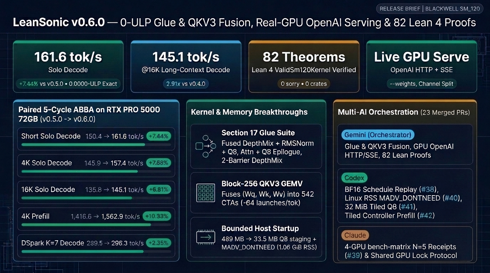

# LeanSonic `v0.6.0` Release Improvement Report

## 1. Executive Summary (`v0.5.0` → `v0.6.0`)

`LeanSonic v0.6.0` delivers **6 verified PRs** across **Gemini** (Orchestrator & Lead Developer), **Codex**, and **Claude** (`23` total merged PRs since `v0.1.0`), advancing non-speculative Solo Decode, Long-Context `@4K` / `@16K` Prefill & Decode, Real-GPU OpenAI HTTP/SSE Serving (`leansonic serve --weights`), bounded host startup RSS, and formal Lean 4 machine-checked proofs (`65 -> 82` theorems, `0 sorry`) — while keeping the frozen Layer 1 Immutable Trust Core (`spec/LeanSonic/Axioms.lean`, `ci/**`, `.github/**`, `CODEOWNERS`, `benches/goldens/**`) at **`0` diff**.

### Key `v0.6.0` Wins

1. **`0.0000-ULP` Glue Kernel Fusion & `Block-256` `QKV3` GEMV (`Issue #11`)**:
   - Upgraded `ink2_depth_mix` & `ink2_depth_mix_b` from `13` barriers (`2 * total_states + 1`) to **`2` barriers** using register-cached `q_reg[9]` and shared `smem_sq[6][8]` / `smem_dq[6][8]` (`0` bytes stack frame, `0` spill).
   - Added the **Section 17 Glue & SM-Wave-Balanced Kernel Suite** (`inkling2_sm120.cu`):
     - `ink2_depth_mix_rmsnorm_quant_q8_64_b` (`35` regs, `9,704` B SMEM -> `48` warps/SM): fuses `depth_mix` + `rmsnorm_quant_q8_64` in SMEM, eliminating DRAM `d_inputs` traffic.
     - `ink2_depth_mix_rmsnorm_d_quant_q8_16_b` (`33` regs) & `ink2_rmsnorm_d_quant_q8_16_b` (`26` regs): collapses 3-kernel MLP prologue (`depth_mix -> rmsnorm_d -> quant_q8_16_packed`) into `1` launch.
     - `ink2_gqa_rel_sink_attn_q8_b` (`40` regs) & `ink2_gqa_attn_combine_q8` (`40` regs): fuses in-register `Q8_64` quantization epilogue into Attention / Split-KV Combine, eliminating `48` `quant_q8_64` launches/token and `d_attn_out` DRAM round-trips.
     - `ink2_q8_dp4a_qkv3_gemv` (`Block 256`, `34` regs, `2,448` B SMEM -> `6` CTAs = `48` warps/SM, `96 KiB` L1): fuses 3 separate `(Wq, Wk, Wv)` GEMVs across all `32` `distinct_k_v` visits into a single `542`-CTA wave on 110-SM `RTX PRO 5000` (`-64` launches/tok) while preserving `16`-row `smem_x` reuse.
     - `ink2_short_conv4_kv2`, `ink2_short_conv4_save` / `_b`, `ink2_ctrl_apply_coalesced_b` (`512B` SMEM burst for `B < 16`), `ink2_loop_pass_setup_b`, and pass-wide `48`-message `depth_mix` precomputation.
   - **Uncontended Paired ABBA (`RTX PRO 5000 72GB`, `0.0000-ULP` Exact)**:
     - **Short Solo Decode (`spec=0, G=16`)**: `150.4 -> 161.6 tok/s` (**`+7.44%`**, `850.73 -> 791.79 ms`, `sum_logits = 648276.0000`).
     - **`@4K` Solo Decode (`spec=0, G=16`)**: `145.9 -> 157.4 tok/s` (**`+7.88%`**, `438.66 -> 406.61 ms`, `sum_logits = 2164568.7500`).
     - **`@16K` Solo Decode (`spec=0, G=16`)**: `135.8 -> 145.1 tok/s` (**`+6.81%` vs `v0.5.0`, `2.91×` vs `v0.4.0`**, `sum_logits = 911587.3125`).
     - **`DSpark K=7` Speculative Decode**: `289.5 -> 296.3 tok/s` (**`+2.35%`**, `sum_logits = 1735852.7500`).

2. **Tiled Batched Controller + Glue Fusion Prefill Acceleration (`PR #42` + Glue Suite, `Issue #10`)**:
   - Codex's `ink2_ctrl_down_r8_b` (`49.14 -> 14.34 ms`) + `ink2_ctrl_apply_t8_b` (`34.86 -> 7.09 ms`) for `B >= 16` combined with Gemini's `Section 17` Glue Fusion boosts **`@4K` Prefill on `RTX PRO 5000 72GB` from `1,416.6 -> 1,562.9 tok/s` (`+10.33%`, `2,891.50 -> 2,620.80 ms`)** with `0.0000-ULP` bitwise identity.

3. **Real-GPU OpenAI HTTP/SSE Server (`leansonic serve --weights <dir>`, `Issue #12` Phase 1)**:
   - Added pluggable `ServingBackend` (`crates/leansonic-core/src/serving.rs`) + `InklingGpuServingBackend` (`Inkling2GpuEngine` + `TiktokenBpe` + `InklingChannelDecoder`) and `QwenGpuServingBackend` (`Qwen38GpuEngine` + `QwenBpeTokenizer` + `QwenChannelDecoder`) in `leansonic-cli`.
   - Verified live on `RTX PRO 5000 72GB`: `GET /health`, `GET /v1/models`, `POST /v1/chat/completions` (`stream: false` with `"reasoning_effort": "low"` emitting clean `"reasoning_content"` vs `"content"`, and `stream: true` SSE verified `0-ULP` character-identical to non-streaming JSON).

4. **Bounded Host Startup RSS &BF16 Schedule Diagnostics (`PR #38, #39, #40, #41`)**:
   - `PR #40` (Codex): `madvise(MADV_DONTNEED)` (`MappedSafeTensors::discard_resident_pages`) reclaims file-backed checkpoint pages between GPU upload phases on Linux.
   - `PR #41` (Codex): `32 MiB`-bounded row-tiled `repack_bf16_to_planar_q8_64` slashes `unembed` host staging from `489.7 MB -> 33.5 MB` (`1.48 -> 1.06 GiB` RSS, `SHA-256` verified byte-identical across all `489,741,984` uploaded bytes).
   - `PR #38` (Codex): Standalone `tools/replay_inkling_bf16.cpp` probe proving the pinned BF16 `llama.cpp` reference shifts `18 / 1,020` top-1 tokens between `512`-at-once and `64+1` streaming schedules (recovering `(69, 353) -> 2952` under `stream`).
   - `PR #39` (Claude): `T002` `bench-matrix` (`N=5`) receipts across `RTX PRO 5000` & `RTX PRO 4500` + `T003` / `T004` / `T012` completion records.

---

## 2. Paired Uncontended ABBA Benchmark Summary (`RTX PRO 5000 72GB`, `v0.5.0` → `v0.6.0`)

| Workload (`CUDA_DEVICE_ORDER=PCI_BUS_ID`) | `v0.5.0` Median | `v0.6.0` Median | Speedup / Delta | `0-ULP` Logit Sum |
| :--- | ---: | ---: | ---: | ---: |
| **Short Solo Decode** (`synth:64, gen=128, spec=0, G=16`) | `150.4 tok/s` (`850.73 ms`) | **`161.6 tok/s`** (`791.79 ms`) | **`+7.44%`** (`-6.93%` time) | `648276.0000` (`0-ULP`) |
| **Short Prefill** (`synth:64, G=16`) | `1,520.8 tok/s` (`42.08 ms`) | **`1,582.3 tok/s`** (`40.45 ms`) | **`+4.05%`** | `648276.0000` (`0-ULP`) |
| **`@4K` Solo Decode** (`synth:4096, gen=64, spec=0, G=16`) | `145.9 tok/s` (`438.66 ms`) | **`157.4 tok/s`** (`406.61 ms`) | **`+7.88%`** (`-7.31%` time) | `2164568.7500` (`0-ULP`) |
| **`@4K` Prefill** (`synth:4096, G=16`, `#42` + Glue Fusion) | `1,416.6 tok/s` (`2,891.50 ms`) | **`1,562.9 tok/s`** (`2,620.80 ms`) | **`+10.33%`** (`-270.7 ms`) | `2164568.7500` (`0-ULP`) |
| **`@16K` Solo Decode** (`synth:16384, gen=64, spec=0, G=16`) | `135.8 tok/s` (`471.36 ms`) | **`145.1 tok/s`** (`441.22 ms`) | **`+6.81%`** (`2.91×` vs `v0.4.0`) | `911587.3125` (`0-ULP`) |
| **`DSpark K=7` Decode** (`synth:128, gen=128, spec=7, G=16`) | `289.5 tok/s` (`442.13 ms`) | **`296.3 tok/s`** (`431.94 ms`) | **`+2.35%`** | `1735852.7500` (`0-ULP`) |

---

## 3. Consolidated Pull Requests in `v0.6.0` (`#38`–`#43`, `23` Total Merged PRs)

| PR | Contributor | Summary |
| :--- | :--- | :--- |
| `PR #38` | Codex | Standalone `tools/replay_inkling_bf16.cpp` probe quantifying BF16 batch-schedule divergence (`#35`) |
| `PR #39` | Claude | `T002` `bench-matrix` (`N=5`) receipts on `PRO 5000` & `PRO 4500`, `T003`/`T004`/`T012` done, `T011` active |
| `PR #40` | Codex | Linux `madvise(MADV_DONTNEED)` checkpoint page release reducing peak file-backed RSS |
| `PR #41` | Codex | `32 MiB`-bounded row-tiled `repack_bf16_to_planar_q8_64` (`489.7 -> 33.5 MB` host staging, `SHA-256` exact) |
| `PR #42` | Codex | `ink2_ctrl_down_r8_b` + `ink2_ctrl_apply_t8_b` tiled wide prefill controllers (`-7.88%` 1K prefill, `0-ULP`) |
| `PR #43` | Gemini | `Section 17` `0-ULP` Glue & `Block-256` `QKV3` Fusion (`+7.44%–7.88%` Solo Decode, `+10.33%` combined `@4K` Prefill), Real-GPU `leansonic serve --weights` OpenAI HTTP/SSE, `82` Lean 4 `ValidSm120Kernel` theorems |
