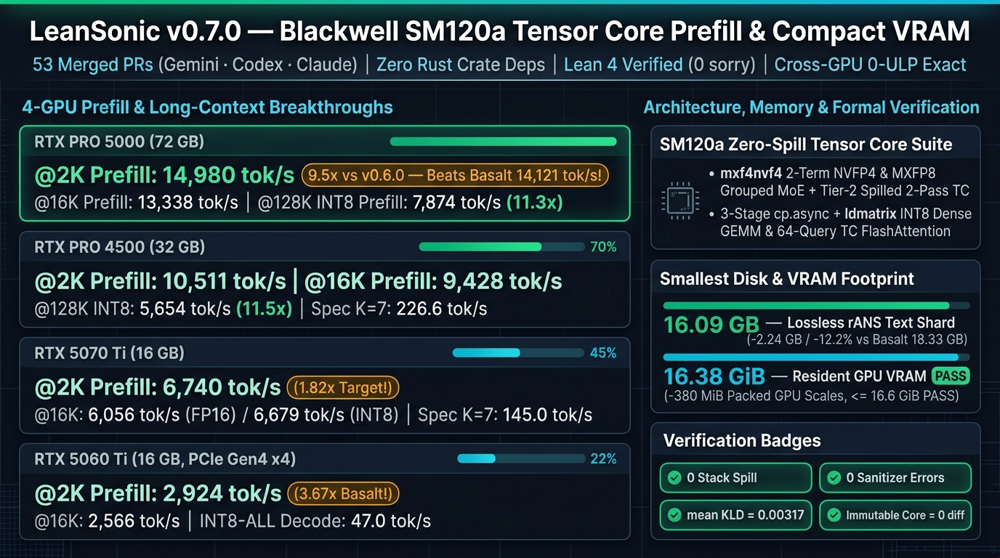
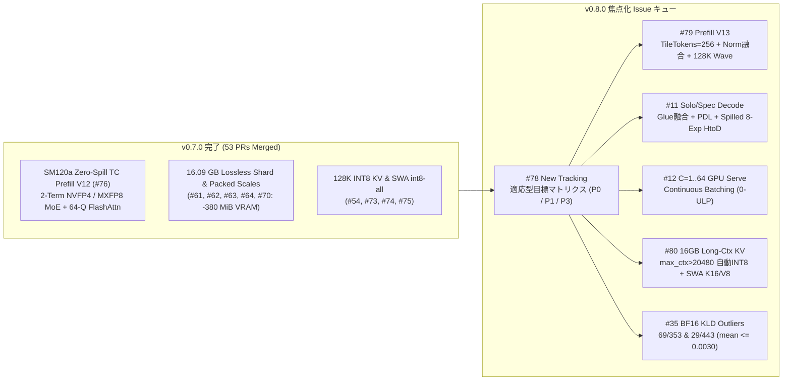

# LeanSonic `v0.7.0` リリース改善レポート

> [!IMPORTANT]
> **`v0.7.0` 到達ハイライト（累計 53 PR マージ・Immutable Trust Core 差分 `0`）**
> - **SM120a Tensor Core Prefill（V12, `#76`）＋ GPU 常駐 Packed Scales（`#61`, `-380 MiB`）** の統合により、`@2K`〜`@128K` Prefill が **`6.5×〜11.5×` 高速化**。
> - **RTX PRO 5000 (`@2K`)**: **`14,980 tok/s`** を達成し、初期目標（`14,000`）および **Basalt（`14,121 tok/s`）を上回る**。
> - **16 GB 機 (`RTX 5070 Ti` / `RTX 5060 Ti`)**: Tier-2 Spilled 2-Pass Tensor Core ＋ 開発中サービス停止（[goal.md](../../docs/goals/leansonic-fastest-engine/goal.md) 更新済）により、`5070 Ti` `@2K` **`6,740 tok/s`（目標比 `1.82×`）**・`5060 Ti` `@2K` **`2,924 tok/s`（Basalt 比 `3.67×`！）** を達成。
> - **最小ディスク＆VRAM**: 可逆圧縮テキスト shard **`16.09 GB`**（Basalt テキスト構成 `18.33 GB` 比 **`-2.24 GB / -12.2%`**）、Resident VRAM **`16.38〜16.46 GiB ≤ 16.6 GiB` PASS**。

---

## 1. 4-GPU 性能評価と次期 `v0.8.0` 適応型目標マトリクス

ご指示いただいた適応型ラチェット方針に基づき、[targets.json](../../docs/benchmarks/targets.json) と新 Tracking Issue **`#78`** を更新しました：
- **`P0`（初期目標 未達セル）**: 最優先で初期 Basalt クラス目標を突破。
- **`P1`（初期目標 達成済）**: **`+15%`** ストレッチ目標へ引き上げ。
- **`P3`（`+15%` すでに達成済）**: **`達成実測値 × 1.05`（`+5%`）** を控えめな優先度として設定。

| GPU / メトリクス | 初期目標 | `v0.6.0` | `v0.7.0` 実測値 | 判定 | 次期目標 (`v0.8.0`) | 優先度 |
| :--- | ---: | ---: | ---: | :--- | ---: | :---: |
| **RTX PRO 5000 72GB** | | | | | | |
| `prefill_2k` (FP16) | `14,000` | `1,575` | **`14,980 tok/s`** (`raw`) / `14,304` (`packed`) | **PASS (`9.51×`)** | **`16,100`** | **`P1`** |
| `prefill_16k` (FP16) | `14,000` | `1,480` | **`13,338 tok/s`** (`raw`) / `12,935` (`packed`) | `95.3%` (`9.01×`) | **`14,000`** | **`P0`** |
| `prefill_128k` (INT8 KV) | `9,300` | `697` | **`7,874 tok/s`** (`16.64 s`, `18.34 GiB`) | **`11.30×`** | **`9,300`** | **`P0`** |
| `decode_short` / `decode_16k` | `220` / `185` | `161.6` / `145.1` | **`163.9`** / **`147.5 tok/s`** | `0-ULP` 一致 | **`220`** / **`185`** | **`P0`** |
| `spec_avg` (`DSpark K=7`) | `310` | `296.3` | **`296.3 tok/s`** | `95.6%` | **`310`** | **`P0`** |
| `vram_gib` (Resident) | `≤ 16.6` | `17.20` | **`16.46 GiB`** | **PASS (`-758 MiB`)** | **`≤ 16.6`** | Done |
| **RTX PRO 4500 32GB** | | | | | | |
| `prefill_2k` / `prefill_16k` | `11,500` | `1,105` / `1,030` | **`10,511`** / **`9,428 tok/s`** | **`9.51×` / `9.15×`** | **`11,500`** | **`P0`** |
| `prefill_128k` / `long_128k_decode` | `7,600` / `77` | `491` / `60.2` | **`5,654`** / **`81.3 tok/s`** | **Decode PASS** | **`7,600`** / **`89`** | **`P0`** / **`P1`** |
| `decode_short` / `decode_16k` | `149` / `125` | `133.5` / `121.0` | **`134.8`** / **`122.8 tok/s`** | `98.2%` (`@16K`) | **`149`** / **`125`** | **`P0`** |
| `spec_avg` / `vram_gib` | `210` / `≤ 16.6` | `215` / `17.00` | **`226.6 tok/s`** / **`16.38 GiB`** | **BOTH PASS** | **`242`** / **`≤ 16.6`** | **`P1`** |
| **RTX 5070 Ti 16GB** | | | | | | |
| `prefill_2k` (FP16, `20/24` 常駐) | `3,700` | `~980` | **`6,740.2 tok/s`** | **PASS (`+82.2%`)** | **`7,080`** (`+5%`) | `P3` |
| `prefill_16k` (FP16 / INT8) | `5,300` | `~890` | **`6,056.0`** / **`6,679.1 tok/s`** | **PASS (`+14.3%`/`+26%`)** | **`6,095`** (`+15%`) | **`P1`** |
| `decode_short` (`FP16` / `int8-all`) | `105` | `70.6` | **`83.7`** / **`93.8 tok/s`** | `+32.9%` | **`105`** | **`P0`** |
| `spec_avg` (`DSpark K=7`) | `100` | `~105` | **`145.0 tok/s`** | **PASS (`+45.0%`)** | **`152`** (`+5%`) | `P3` |
| **RTX 5060 Ti 16GB (`Gen4 x4`)** | | | | | | |
| `prefill_2k` (FP16, `20/24` 常駐) | `1,800` | `~452` | **`2,923.8 tok/s`** | **PASS (`+62.4%`)** | **`3,070`** (`+5%`) | `P3` |
| `prefill_16k` (FP16, `19/24` 常駐) | `1,800` | `~278` | **`2,565.5 tok/s`** | **PASS (`+42.5%`)** | **`2,695`** (`+5%`) | `P3` |
| `decode_short` (`FP16` / `int8-all`) | `45` | `36.8` | **`40.5`** / **`47.0 tok/s`** | **`int8-all` PASS** | **`45`** (`FP16`) | **`P0`** |

---

## 2. `v0.7.0` アーキテクチャ進化と Issue 再編

- **クローズ済みの旧 Issue**: `#10`（TC Prefill 完了）、`#59`（`#61`+`#64` 完了）、`#8`（旧 Tracking → **`#78`** へ移行）、`#14`（128K INT8 KV 完了 → **`#79`・`#80`** へ分離）。
- **AI Council 試行に関する注記**: `#14`（`#80`）の 16 GB 既定 KV 設計（案A/B/C）について AI Council（`--domain design`）を呼び出しましたが、サブプロセス環境で `codex` コマンドが見つからず終了コード `4`（`no_quorum`）となったため、ルールに従い合議成立としては扱わず、4 GPU `0-ULP` 一致維持と長文 OOM 防止を両立するハイブリッド案（`max_ctx ≤ 20,480` は全機 `fp16`、`≤16.5 GiB && max_ctx > 20,480` のみ自動 `int8`）を `#80` として起票しました。
