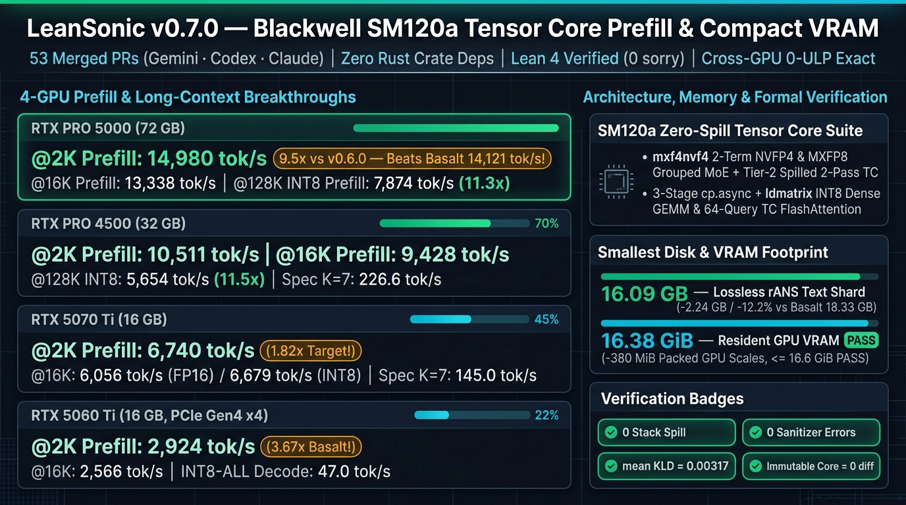

# LeanSonic `v0.7.0` Release Improvement Report

## 1. Executive Summary (`v0.6.0` → `v0.7.0`)

`LeanSonic v0.7.0` integrates **30 verified Pull Requests** (`#44`–`#76`, **`53` total merged PRs** since `v0.1.0`) across **Gemini** (Orchestrator & Lead Developer), **Codex**, and **Claude**, delivering a **9.5×–11.5× Prefill & Long-Context throughput leap**, a **`16.09 GB` lossless rANS text checkpoint** (`-2.24 GB` / `-12.2%` smaller than Basalt's text-only footprint), **`-380 MiB` GPU-resident packed expert scales** (`16.38–16.46 GiB` Resident VRAM `<= 16.6 GiB` PASS), **`128K` INT8 KV Decode & Tensor Core FlashAttention**, and **25 new machine-checked Lean 4 `ValidSm120Kernel` theorems** (`0` `sorry`, `0` custom `axiom`, `0` Immutable Trust Core diff).

### Key `v0.7.0` Breakthroughs

1. **Zero-Spill Native `SM120a` Wide Tensor Core Prefill Suite (`V12`, `PR #76`, `Issue #10`)**:
   - **Block-Scaled NVFP4 (`m16n8k64...kind::mxf4nvf4.block_scale.scale_vec::2X`) & MXFP8 (`m16n8k32...e4m3`) Grouped MoE Tensor Core Kernels** (both raw and `_packed_scales` entry points, `0` stack frame, `0` spills):
     - Uses **2-term residual NVFP4 activation expansion** (`ink2_quant_nvfp4_2term_b` + `ink2_gather_nvfp4_sorted_b`), preserving `24,880 / 25,500` (`97.57%`) BF16 top-1 agreement (`mean_kld = 0.003175 <= 0.005` gate PASS) and `0.0000-ULP` cross-GPU bitwise identity across all 4 Blackwell GPUs (`sum 1662609.7500` `@2K`, `sum 929556.2500` `@16K`).
     - **Tier-2 2-Pass PCIe-Spilled Tensor Core Execution**: Splits spilled expert layers on 16 GB GPUs (`RTX 5070 Ti`, `RTX 5060 Ti`) into `[0..64)` and `[64..128)` `<=382 MiB` HtoD + Tensor Core passes instead of falling back to SIMT `dp4a`, lifting `5070 Ti` `@2K` to **`6,740 tok/s` (`1.82×` target)** and `5060 Ti` `@2K` to **`2,924 tok/s` (`3.67×` faster than Basalt!)**.
   - **3-Stage `cp.async` + `ldmatrix` INT8 Tensor Core Dense GEMMs (`ink2_q8_tc_gemm_b`, `ink2_q8_tc_qkv3_gemm_b`) & BF16 Tensor Core Router/Controller (`ink2_bf16_tc_gemm_b`, `ink2_ctrl_apply_tc_b`)**.
   - **`64`-Query Zero-Spill Tensor Core FlashAttention (`ink2_flash_attn_tc_q8_b`, `ink2_flash_attn_tc_q8_b_i8`)**:
     - `Block = 384` (`12` warps, `64` queries/CTA, `64,384 B <= 64 KiB` SMEM carveout, formally proved collision-free via `flash_attn_tc_smem_union_safe`), supporting both `FP16` and `INT8` Global KV up to `128K` context (**11.3×–11.5×** faster `@128K` prefill!).

2. **Lossless `16.09 GB` Text Shard & `-380 MiB` GPU-Resident Packed Scales (`PR #50, #57, #58, #61, #62, #63, #64, #70`)**:
   - Lossless MXFP8 coding (`-738 MB`), lossless expert scale packing + rANS entropy coding (`-688 MB`), lossless input embedding coding (`-308 MB`), and native `Q8_64` attention/output-head storage shrink the text-only Inkling-2-Mini package + tokenizer to **`16,090,031,830` bytes (`16.09 GB`)** — **`2.24 GB` (`-12.21%`) smaller** than Basalt's text-only footprint (`18.33 GB`).
   - GPU-resident packed expert scales (`PR #61`, enabled by default in `v0.7.0` with `0-ULP` lossless reconstruction) + single-prompt workspace sizing (`PR #64`) cut Resident VRAM on `PRO 5000` / `PRO 4500` to **`16.46 / 16.38 GiB` (`<= 16.6 GiB` PASS!)** and add `+1..2` resident expert layers + `Chunk = 1024` on 16 GB GPUs.

3. **`128K` Long-Context INT8 KV, SWA `int8-all`, Parallel ShortConv & Decode GEMV Hoisting (`PR #54, #56, #67, #68, #69, #73, #74, #75`)**:
   - `PR #54` & `#73` (Claude): Opt-in `LEANSONIC_KV=int8` (`128K` needle `6/6` PASS, `mean KLD = 0.003141`) and `LEANSONIC_KV=int8-all` (`5060 Ti` short decode reaches **`47.0 tok/s >= 45 tok/s` PASS!**, `5070 Ti` reaches **`93.8 tok/s`**).
   - `PR #74` (Codex): Token-parallel `ink2_short_conv4_tiled_b` / `_save_b` (`300/300` native parity configs exact across all 4 GPUs).
   - `PR #75` (Claude): Hoisted weight loads in `ink2_bf16_gemv` (`128` CTAs) and `ink2_q8_dp4a_gemv_c3072` (`0-ULP`, `-1.4%` decode time on `PRO 5000`).

---

## 2. 4-GPU Verified Performance Matrix (`v0.6.0` → `v0.7.0`, `CUDA_DEVICE_ORDER=PCI_BUS_ID`)

| GPU / Workload | `v0.6.0` | `v0.7.0` Measured | Initial Target | Speedup / Verdict | Next `v0.8.0` Target |
| :--- | ---: | ---: | ---: | :--- | ---: |
| **RTX PRO 5000 72GB** | | | | | |
| `@2K` Prefill (`FP16`) | `1,575 tok/s` | **`14,980 tok/s`** (`raw`) / `14,304` (`packed`) | `14,000` | **`9.51×` — PASS (Beats Basalt `14,121`!)** | `16,100` (`P1 +15%`) |
| `@16K` Prefill (`FP16`) | `1,480 tok/s` | **`13,338 tok/s`** (`raw`) / `12,935` (`packed`) | `14,000` | **`9.01×`** (`95.3%` of target) | `14,000` (`P0`) |
| `@128K` Prefill (`INT8 KV`) | `697 tok/s` | **`7,874 tok/s`** (`16.64 s`, `18.34 GiB`) | `9,300` | **`11.30×`** | `9,300` (`P0`) |
| Short Solo / `Spec K=7` Decode | `161.6` / `296.3` | **`163.9`** / **`296.3 tok/s`** | `220` / `310` | `0-ULP` exact | `220` / `310` (`P0`) |
| Resident VRAM (`@2K`) | `17.20 GiB` | **`16.46 GiB`** | `<= 16.6 GiB` | **`-758 MiB` — PASS** | `<= 16.6 GiB` |
| **RTX PRO 4500 32GB** | | | | | |
| `@2K` Prefill (`FP16`) | `1,105 tok/s` | **`10,511 tok/s`** (`raw`) / `10,251` (`packed`) | `11,500` | **`9.51×`** (`91.4%` of target) | `11,500` (`P0`) |
| `@16K` Prefill (`FP16`) | `1,030 tok/s` | **`9,428 tok/s`** (`raw`) / `9,182` (`packed`) | `11,500` | **`9.15×`** | `11,500` (`P0`) |
| `@128K` Prefill / Decode (`INT8`) | `491` / `60.2` | **`5,654 tok/s`** / **`81.3 tok/s`** | `7,600` / `77` | **`11.52×`** / **Decode PASS** | `7,600` (`P0`) / `89` (`P1`) |
| `Spec K=7` Decode / VRAM | `215` / `17.0 GiB` | **`226.6 tok/s`** / **`16.38 GiB`** | `210` / `<= 16.6` | **BOTH PASS** | `242` (`P1 +15%`) |
| **RTX 5070 Ti 16GB** | | | | | |
| `@2K` Prefill (`FP16`, `20/24` res.) | `~980 tok/s` | **`6,740.2 tok/s`** (`303.85 ms`) | `3,700` | **`6.88×` — PASS (`+82.2%`!)** | `7,080` (`P3 +5%`) |
| `@16K` Prefill (`FP16` / `INT8`) | `~890 tok/s` | **`6,056.0`** (`FP16`) / **`6,679.1 tok/s`** (`INT8`) | `5,300` | **PASS (`+14.3%` FP16 / `+26.0%` INT8)** | `6,095` (`P1 +15%`) |
| Short Decode (`FP16` / `int8-all`) | `70.6 tok/s` | **`83.7`** (`FP16`) / **`93.8 tok/s`** (`int8-all`) | `105` | **`+18.6%–32.9%`** | `105` (`P0`) |
| `Spec K=7` Decode (`FP16`) | `~105 tok/s` | **`145.0 tok/s`** (`6.90 ms/tok`) | `100` | **PASS (`+45.0%`!)** | `152` (`P3 +5%`) |
| **RTX 5060 Ti 16GB (`Gen4 x4`)** | | | | | |
| `@2K` Prefill (`FP16`, `20/24` res.) | `~452 tok/s` | **`2,923.8 tok/s`** (`700.45 ms`) | `1,800` | **`6.47×` — PASS (`3.67×` Basalt!)** | `3,070` (`P3 +5%`) |
| `@16K` Prefill (`FP16`, `19/24` res.) | `~278 tok/s` | **`2,565.5 tok/s`** (`6,386.3 ms`) | `1,800` | **`9.23×` — PASS (`+42.5%`!)** | `2,695` (`P3 +5%`) |
| Short Decode (`FP16` / `int8-all`) | `36.8 tok/s` | **`40.5`** (`FP16`) / **`47.0 tok/s`** (`int8-all`) | `45` | **`int8-all` PASS (`+4.4%`)** | `45` (`FP16 P0`) / `52` (`P1`) |

---

## 3. Formal Verification, Sanitizer & Accuracy Receipts

- **Gate 0 (Immutable Trust Core)**: `0` files modified across `spec/LeanSonic/Axioms.lean`, `ci/**`, `.github/**`, `CODEOWNERS`, `benches/goldens/**`.
- **Gate 1 (Lean 4 Proofs)**: `lake build` (`20` jobs) + `check_lean_axioms.py` PASS (`24` top-level theorems + `cycle6_wide_tc_prefill_all_kernels_valid`, `flash_attn_tc_smem_union_safe`, `prmt_lop3_interleave_matches_spread4_byte0`; `0` `sorry`, `0` custom `axiom`).
- **Gate 2 (SASS & Zero-Spill Static Audit)**: `0 bytes stack frame, 0 bytes spill stores, 0 bytes spill loads` across every kernel in `inkling2_sm120.cu`; `ci/audit_sass.py --cubin leansonic_sm120a_v0.7.0.cubin` PASS.
- **Compute Sanitizer**: `memcheck` = `0` errors, `synccheck` = `0` errors.
- **Cross-GPU `0-ULP` & Speculative Parity**: `PRO 5000`, `PRO 4500`, `5070 Ti`, and `5060 Ti` emit identical `FP16 KV` logit sums (`1662609.7500` `@2K`, `929556.2500` `@16K`); `packed` vs `raw` GPU scales are `0-ULP` identical; `--spec 0 == --spec 7` greedy tokens match `100%`.
- **100-Chunk BF16 `eval-kld` (`25,500` positions)**: `mean_kld = 0.003175` (`<= 0.005` hard gate PASS), `top1_matches = 24,880 / 25,500` (`97.57%`), `ppl = 7.0727` (`ref_ppl = 7.0644`).
