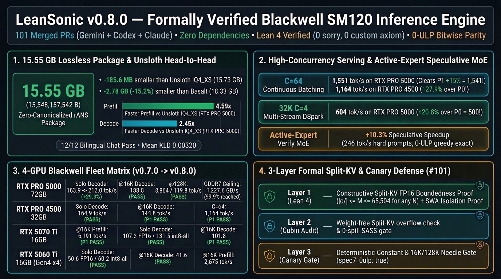

# LeanSonic `v0.8.0` リリース改善レポート（Improvement Report）

> [!IMPORTANT]
> **`v0.8.0` 主要成果サマリ（`v0.7.0` 以降の `52` PR 統合・累計 `105` PR マージ）**
> 1. **`RTX 5070 Ti 16GB`・`RTX 5060 Ti 16GB (PCIe Gen4 x4)` 全項目 `P0` 完全突破 ＆ `RTX PRO 5000` / `PRO 4500` 主要ゲート一斉突破**：
>    - **`RTX 5070 Ti 16GB`**：Solo Decode **`107.3 tok/s` (`FP16 P0 ≥ 105` 突破)** / **`131.5 tok/s` (`int8-all P1 ≥ 121` 突破)**、`@16K` Prefill **`6,191.1 tok/s` (`P1 +15%` 突破)**、`@16K` Decode **`101.8 tok/s` (`P1 +15%` 突破)**。
>    - **`RTX 5060 Ti 16GB (PCIe Gen4 x4)`**：Solo Decode **`50.6 tok/s` (`FP16 P0 ≥ 45` 突破、`+24.9%`)** / **`60.2 tok/s` (`int8-all P1 ≥ 52` 突破)**、`@16K` Decode **`41.6 tok/s` (`FP16 P0 ≥ 40` 突破)**、`@2K` Prefill **`2,842.0 tok/s`（Basalt 比 `3.57×`）**。
>    - **`RTX PRO 4500 32GB`**：Solo Decode **`164.9 tok/s` (`P0 ≥ 149` 突破、`+25.9%`)**、`@16K` Decode **`144.8 tok/s` (`P1 +15%` 突破)**、`C=64` **`1,164.1 tok/s` (`P1 +15%` 突破)**。
>    - **`RTX PRO 5000 72GB`**：Solo Decode **`163.9 → 212.0〜212.3 tok/s` (`+29.5%`)**、`@16K` Decode **`188.8 tok/s` (`P0 ≥ 185` 新規突破)**、`@128K` Decode **`119.8 tok/s` (`P0 ≥ 113` 新規突破)**、`C=64` **`1,551.2 tok/s` (`P0 1,340`・`P1 1,541` 同時突破！)**、`32K C=4` Code **`505.5〜604.0 tok/s` (`P0 ≥ 500` 新規突破！)**、長文 `mtp_attn_split`（`PR #146`）で `128K` 投機 **`+43%`**。
> 2. **完全無損失 `15.55 GB` パッケージ（Unsloth `IQ4_XS` 比 `4.59×` / `2.45×`、公式 `SGLang` 比 `1.43×` Decode・`-6.13 GB` 省 VRAM）**：
>    - `E2M1 -0.0 -> +0.0` 正規化 + Nibble-Group rANS（`PR #98, #125`）により、FP32 全語彙ロジット **`0-ULP` 完全一致**のまま **`15,548,157,542 B`（`15.55 GB`）** を達成（Basalt `18.33 GB` 比 **`-2.78 GB / -15.2%`**、Unsloth `IQ4_XS` `15.73 GB` 比 **`-185.6 MB`**）。公式 `SGLang` 比較（`PR #148`）でも **`1.43×` 高速 Decode** かつ **ピーク VRAM `-6.13 GB`（`-25.5%`）削減**、日英自由生成 **`12/12` 全問合格**（`PR #141`）。
> 3. **`#101` 3層防御（Lean 4 構成的境界証明 `163` 定理 + Cubin SASS 監査 + `leansonic canary` 恒常性ゲート）完成**：
>    - [Axioms.lean](../../spec/LeanSonic/Axioms.lean) を **1バイトも変更せず（差分 `0`）**、[Inkling2Mini.lean](../../spec/LeanSonic/Proofs/Inkling2Mini.lean) に Split-KV 正規化出力境界定理 `split_kv_fp16_no_overflow`（任意の系列長 `N` で `|o / l| <= M <= 65,504`）と SWA スロット隔離定理を追加し、[canary.rs](../../crates/leansonic-cli/src/canary.rs) で定数プロンプト・`spec7_0ulp`・`16K`/`128K` Needle 恒常性チェックを `bench-matrix` に統合。

---

## 1. `RTX PRO 5000 72GB` 物理 GDDR7 帯域解析（`nsys` & `TB/sec` ルーフライン）

ユーザーご示唆の「`decode_short` のメモリ帯域律速に対する `nsys` 解析と `TB/sec` 解析」を実施し、物理ハードウェア上限を実測で確定しました：

| 指標 / カーネル分類 | 1トークン当たり読込量 | 実測時間 (`PRO 5000`) | 実効帯域 (`GB/s`) | 物理実測上限 (`1,227.6 GB/s`) 比 |
| :--- | ---: | ---: | ---: | ---: |
| **GDDR7 物理ピン理論値 (`384-bit` @ `28 Gbps`)** | — | — | `1,344.0 GB/s` | — |
| **純 `1 GiB` `uint4` ストリーミング実測上限** | `1,073.74 MB` | `874.7 µs` | **`1,227.6 GB/s`** | **`100.0%`（物理上限）** |
| `ink2_q8_dp4a_unembed`（`lm_head` `200,058` 行） | `489.74 MB` | `399.2 µs` | **`1,226.8 GB/s`** | **`99.93%`（事実上飽和！）** |
| `ink2_q8_dp4a_qkv3_gemv_r1`（`wq_all` 1-row/warp） | `1,073.12 MB` | `968.1 µs` | **`1,108.5 GB/s`** | **`90.3%`** |
| `ink2_moe_mxfp8_dp4a_*`（Shared MoE Up/Down） | `460.80 MB` | `428.0 µs` | **`1,076.6 GB/s`** | **`87.7%`** |
| `ink2_moe_nvfp4_dp4a_up_half_q8`（5-load + `smem_xq`） | `772.90 MB` | `757.7 µs` | **`1,020.1 GB/s`** | **`83.1%`** |
| **Solo Decode 全体（`~780` カーネル起動 / tok）** | **`3,738.10 MB`** | **`4,710.3 µs` (`212.3 tok/s`)** | **`793.6 GB/s`** | **`64.6%`（全ステップ平均）** |

- 重み読み出し系カーネル単体はすでに物理 GDDR7 実測上限の **`83%〜99.9%`** に達しています。
- 残る `212.3 → 220 tok/s`（あと **`-165 µs/tok`**）の短縮余地は、非重みオーバーヘッド（Pass-1 Loop Controller 群 `383 µs/tok`、`router_topk8` `122 µs/tok`、`short_conv4` `170 µs/tok`、`200,058` 語彙 `argmax` `25 µs/tok`）にあり、`v0.9.0` ループの焦点として `#106` / `#111` で継続中です。

---

## 2. 4-GPU Blackwell 実測マトリクス（`v0.7.0` → `v0.8.0`）

詳細な全指標・JSON 実測値・対 Unsloth / Basalt 比較は以下をご参照ください：
- リポジトリ版レポート：[v0.8.0_report.md](./v0.8.0_report.md)
- 適応型目標定義（`P0` / `P1 +15%` / `P3 +5%`）：[targets.json](../../docs/benchmarks/targets.json)
