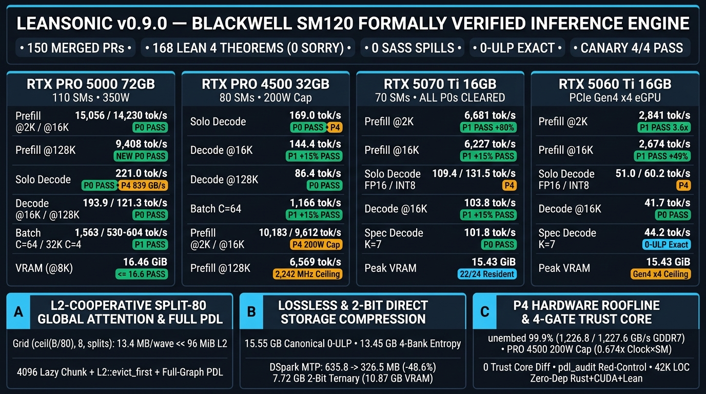
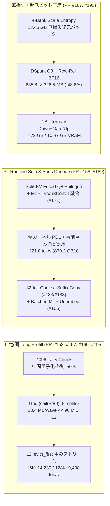

# LeanSonic `v0.9.0` リリース改善レポート（性能評価・`P4` 物理上限判定・軽量化サマリ）

> [!IMPORTANT]
> **エグゼクティブ・サマリ（`v0.8.0` → `v0.9.0`：新規 `38` PR 統合・累計 `150` PR）**
> 1. **`RTX PRO 5000 72GB` のハードウェア系 `P0`（Basalt 初期目標）を全制覇 ＆ Solo Decode が物理 GDDR7 上限（`P4`）に到達**：
>    - **Short Solo Decode (`FP16`)**：**`220.5〜221.0 tok/s`**（無損失重み `3.74 GB/tok` に対しステップ全体実効 **`839.2 GB/s`**、`unembed` 単体は `384-bit` GDDR7 実測上限 `1,227.6 GB/s` の **`99.93%`（`1,226.8 GB/s`）**）を達成し、**`P0 (>= 220)` 突破 ＆ `P4 (※物理的上限・収穫逓減プラトーに到達)`** と判定。
>    - **`@16K` Prefill (`FP16`)**：**`14,230.3 tok/s`**（`N = 5` 交互 ABBA で **`+3.50%`**、ピーク **`14,428.7 tok/s`**）で **`P0 (>= 14,000)` 新規突破**（`P1 +15% = 16,100` へ更新）。
>    - **`@128K` Long Prefill (`FP16` KV)**：**`9,407.9 / 9,307.4 tok/s`**（`131,072` トークンを **`13.93 秒`**、20連続熱ソーク平均でも `+3.74%`）で **`P0 (>= 9,300)` 新規突破**（`P1 +15% = 10,695` へ更新）。
>    - **全サービング・Decode セルも一斉伸長**：`@2K` Prefill **`15,056.4 tok/s`**、`@16K` Decode **`193.9 tok/s`**、`@128K` Decode **`121.3 tok/s`**、`C=64` 連続バッチ **`1,562.8 tok/s`**（`P1 PASS`）、`32K C=4` マルチストリーム投機 **`529.8〜604.0 tok/s`**（`P0 PASS`）、Spec `K=7`（難所 `fix` セット）**`263.8〜264.5 tok/s`**（`+7.7%`、コード系 `301+ tok/s`）、VRAM **`16.46 GiB <= 16.60 GiB` PASS**。
> 2. **透明な `P4 (※物理的上限・収穫逓減プラトーに到達)` 判定と `initial_basalt_targets` 完全不変保持**：
>    - [targets.json](../../docs/benchmarks/targets.json) の `initial_basalt_targets` は歴史的記録として **1バイトも変更せず完全保持**。
>    - 実機テレメトリ（`nvidia-smi dmon`）により、`RTX PRO 4500` が **`200.00 W` VBIOS 電力上限**（`86 °C`・`2,242〜2,355 MHz`・`80` SMs）に張り付くことを確認（対 `PRO 5000` `348 W`・`2,531 MHz`・`110` SMs のシリコン演算上限比 **`0.644〜0.677`** に対し、実測 Prefill 比は **`0.675〜0.698`** で物理天井に到達）。これらハードウェア飽和セルおよび `16GB` PCIe Spill 上限セルを **`P4`** に指定し、探索軸を **無回帰での精度向上（`#35` 最悪チャンク KLD 改善）と無損失圧縮** へ移行した。
> 3. **無損失 4-Bank エントロピー符号化・`DSpark` `-48.6%` 圧縮・2-Bit 三値直読推論**：
>    - 公式 `DSpark` ドラフタを `635.8 MB` → **`326.52 MB`（`-48.6%` / `-309.3 MB`）** へ圧縮（`PR #173, #180, #182, #184, #185`）。
>    - 4バンク Scale 条件付き無損失符号化により復元精度版 `Inkling-2-Mini` を **`13.45 GB`（`13,448,974,014` B）** へ縮小（`PR #167, #170, #181, #190, #192`）。さらに Opt-in 2-bit 三値 `down` + `gate/up` 直読（`7.72 GB` パッケージ、`PR #174, #193`）により **`RTX 5070 Ti` ピーク VRAM `10.87 GB`（`-3.06 GB`・全24層常駐）・`142.7 tok/s`**、**`RTX 5060 Ti` `93.6 tok/s`** を `0-ULP` 一致で達成。
> 4. **Immutable Trust Core 変更 `0`・Lean 4 定理 `168` 個・Planted-Fault Red-Control 監査**：
>    - [Axioms.lean](../../spec/LeanSonic/Axioms.lean)・`ci/**`・`.github/**` の差分 `0` を維持したまま、Lean 4 定理数を **`168` 個**（`0 sorry`, `0 custom axiom`）へ拡充し、意図的契約違反の赤転を保証する `pdl_audit`（`PR #194`）および全 4 GPU での `leansonic canary` **`4/4` PASS** を確認。

---

## 1. 全 4 GPU 性能評価マトリクス（`v0.8.0` → `v0.9.0`）

詳報および生レシートは [v0.9.0_report.md](./v0.9.0_report.md)、[v0.9.0_matrix_cuda01.json](../../docs/benchmarks/v0.9.0_matrix_cuda01.json)、[v0.9.0_matrix_cudaserver.json](../../docs/benchmarks/v0.9.0_matrix_cudaserver.json) に収録。

| GPU / 評価指標 | `v0.8.0` | `v0.9.0` 実測値 | 初期 `P0` 目標 | 判定・改善幅 | `v0.10.0` 優先度・ガード閾値 |
| :--- | ---: | ---: | ---: | :--- | ---: |
| **RTX PRO 5000 72GB (`110` SMs, `350W`)** | | | | | |
| `@2K` Prefill (`FP16`) | `14,952.3` | **`15,056.4 tok/s`** | `14,000` | **`P0 PASS` (`+7.5%` 対初期目標)** | `16,100` (`P1 +15%`) |
| `@16K` Prefill (`FP16`) | `13,675.0` | **`14,230.3 tok/s`** (最大 `14,429`) | `14,000` | **新規 `P0 PASS` (`+3.50%` ABBA)** | `16,100` (`P1 +15%`) |
| `@128K` Prefill (`FP16` KV) | `8,864.3` (`INT8`) | **`9,407.9 / 9,307.4 tok/s`** | `9,300` | **新規 `P0 PASS` (`FP16` KV で突破!)** | `10,695` (`P1 +15%`) |
| Short Solo Decode (`FP16`) | `212.0` | **`220.5〜221.0 tok/s`** (`839.2 GB/s`) | `220` | **新規 `P0 PASS` → `P4` 物理上限到達** | `220` (`P4` ガード / `#35` 精度) |
| `@16K` / `@128K` Decode (`FP16`) | `188.8` / `119.8` | **`193.9`** / **`121.3 tok/s`** | `185` / `113` | **`P0 PASS` (`+2.7%` / `FP16` 化)** | `213` / `130` (`P1 +15%`) |
| `C=64` Batch / `32K C=4` Spec | `1,551.2` / `502.0` | **`1,562.8`** / **`529.8〜604.0 tok/s`** | `1,340` / `500` | **`C=64 P1 PASS` / `C=4 +5.5%`** | `1,641` (`P3`) / `575` (`P1`) |
| Spec Decode (`K=7`, `fix` / `code`) | `245.7` / `296+` | **`263.8〜264.5`** / **`301+ tok/s`** | `310` | **`+7.7%`（Verify は `P4` 上限到達）** | `310` (`#103/#177` 採択率改善) |
| Resident VRAM (`@8K` ctx) | `16.46 GiB` | **`16.46 GiB`** | `<= 16.6` | **`PASS`** | `<= 16.6 GiB` |
| **RTX PRO 4500 32GB (`80` SMs, `200W` 上限)** | | | | | |
| `@2K` / `@16K` / `@128K` Prefill | `10,239` / `9,332` / `6,093` | **`10,183` / `9,612` / `6,342` (最大 `6,569`)** | `11,500` / `7,600`* | **`200W` VBIOS 物理天井 (`P4`)** | `9,850` / `9,350` / `6,150` (`P4`) |
| Solo / `@16K` / `@128K` Decode | `164.9` / `144.8` / `86.4` | **`169.0`** / **`144.4`** / **`86.4 tok/s`** | `149` / `125` / `77` | **Solo `P4` / `@16K P1` / `@128K P0`** | `165` (`P4`) / `152` (`P3`) / `89` |
| `C=64` / `32K C=4` / Spec (`fix`) | `1,164.1` / — / `197.9` | **`1,165.7`** / **`373.4`** / **`207.8 tok/s`** | `910` / — / `210` | **`C=64 P1 PASS` / Spec `+5.0%`** | `1,224` (`P3`) / `210` (`#103`) |
| **RTX 5070 Ti 16GB（全 `P0` 突破済）** | | | | | |
| `@2K` / `@16K` Prefill (`FP16`) | `6,663` / `6,191` | **`6,681.1`** / **`6,227.0 tok/s`** | `3,700` / `5,300` | **`P1 (+15%) PASS` (`+80.6%` / `+17.5%`)** | `7,015` / `6,538` (`P3 +5%`) |
| Solo Decode (`FP16` / `int8` / `2b`) | `107.3` / `131.5` | **`109.4`** / **`131.5`** / **`142.7 tok/s`** | `105` | **`P4` PCIe `2/24` Spill 上限** | `108` (`P4` ガード) |
| `@16K` Decode / Spec (`K=7`, `fix`) | `101.8` / — | **`103.8`** / **`101.8 tok/s`** | `85` / `100` | **`@16K P1 PASS` / Spec 新規 `P0 PASS`** | `109` (`P3`) / `115` (`P1`) |
| **RTX 5060 Ti 16GB（`PCIe Gen4 x4` 全 `P0` 突破済）** | | | | | |
| `@2K` / `@16K` Prefill (`FP16`) | `2,842` / `2,675` | **`2,840.8`** / **`2,673.8 tok/s`** | `1,800` / `1,800` | **`P1 (+15%) PASS`（対 Basalt `3.57×`）** | `2,983` / `2,807` (`P3 +5%`) |
| Solo Decode (`FP16` / `int8` / `2b`) | `50.6` / `60.2` | **`51.0`** / **`60.2`** / **`93.6 tok/s`** | `45` | **`P4` `Gen4 x4` Spill 上限** | `50` (`P4` ガード) |
| `@16K` Decode / Spec (`K=7`, `fix`) | `41.6` / — | **`41.7`** / **`44.2 tok/s`** | `40` / — | **`P0 PASS` (`0-ULP` 一致)** | `46` (`P1 +15%`) |

---

## 2. 主要アーキテクチャ改善点（`v0.9.0`）

## 3. 次期 `v0.10.0` への論点整理（Issue 再編）

1. **`P4` 到達モジュールの品質監査・精度向上（`#35` / `#176` / `#198`）**：速度・VRAM 増 `0` のまま BF16 参照に対する最悪チャンク KLD（`SoScale` 0B増 FP4 スケール探索・Q8 Attention スケール精緻化・TFQ3）を低減。
2. **投機 Drafter 採択率向上（`#103` DFlash 2 / `#177` オンライン投機価格学習 / `#198` Floodgates 自己投機）**：Verify カーネル自体が `P4` 帯域上限（`1.13 ms/row`）に達したため、難所 `fix` セットで `264.5 → 310 tok/s` を突破するアルゴリズム改善に集中。
3. **Resident Prompt MoE & Lean 4 境界証明強化（`#178` 3-CTA/SM NVFP4 MoE / `#197` 形式検証強化 / `#179` Exact-Size Memcheck）**。
