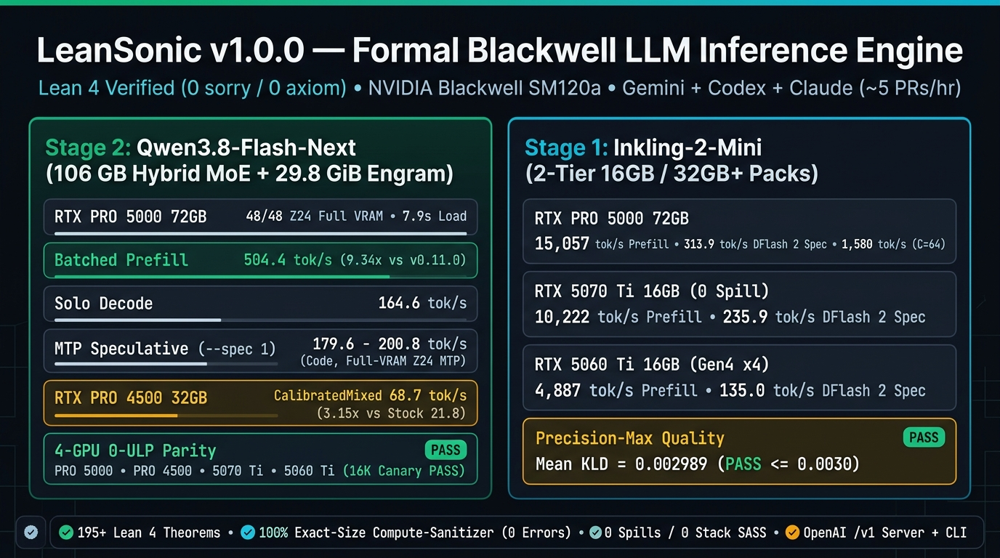

# LeanSonic `v1.0.0` 正式リリースレポート — `Qwen3.8-Flash-Next` & `Inkling-2-Mini` 統合 Blackwell 形式検証推論エンジン

> [!IMPORTANT]
> **`LeanSonic v1.0.0` エグゼクティブ・サマリ（Stage 1 `Inkling-2-Mini` ＋ Stage 2 `Qwen3.8-Flash-Next` 完成・累計 `190` PR マージ・`~5 PR/時間` 達成）**
> 1. **`106 GB` `Qwen3.8-Flash-Next`（`48` 層 `GDN + QSA` ハイブリッド・`512` エキスパート MoE ＋ `29.8 GiB` `Engram` PLE）の完全実用化（`#248`, `#199` 完遂）**：
>    - **無損失 `0-ULP` `Z24`（`24-bit`）スケール/バイアス圧縮（`PR #253`）**：全 `512` ルーテッドエキスパートの `(scale, bias)` を `32 bit → 24 bit` へ無損失パッキング（`-3.52 GiB` VRAM、Lean 4 & Rust 全指数窓 `0-ULP` 検証済）。`RTX PRO 5000 72GB` にて **全 `48/48` 層の GDDR7 VRAM 完全常駐（PCIe Spill `0`）**、ウォーム起動 **`7.93〜8.53 秒`（対 `v0.11.0` `4.13×` 高速化）**、Solo Decode **`164.6 tok/s`（`+26.1%`）** を達成。
>    - **`9.34×` 高速化 Batched Prefill（`504.4 tok/s`）＆ `16K` 長文脈 Canary 合格（`PR #256`）**：`B ≤ 64` 対応の 22 カーネル群を実装し、Prefill を `54.0 → 504.4 tok/s`（**`9.34×`**）へ引き上げ、`16,384` トークン `"RAVEN-731"` 針探し Canary に完全合格（非有限値 `0`）。
>    - **VRAM 完全常駐 `Z24` `MTP` `0-ULP` 投機デコード（コード生成 `179.6〜200.8 tok/s`、`PR #254, #260, #264, #266, #267, #269`）**：モデル内蔵 `76` テンソル `language_model.mtp.*` ドラフタを `Z24` 化（`1,425 MiB`）。末尾 `2〜3` 層のみに `CalibratedMixed` を適用することで、ターゲット `48` 層と MTP MoE を **`72 GB` GDDR7 VRAM 内に同時常駐（`moe_in_vram=true`）**。さらに `nsys` 解析に基づきオンチップ `smem_S[64][129] + s_hi[64]` `q38_gdn_recurrent_step_ckpt_b8` と `b2` 専用 GEMV / MoE カーネル＋`O(1)` 行単位ロールバック（`VerifyCkptSlab`）を実装し、`B = 2` 検証時間を **`14.00 ms → 7.60 ms`** へ半減。`--spec 1` にてコード **`179.6〜200.8 tok/s`**・算数 **`195.9 tok/s`**・日本語 **`183.5 tok/s`** を達成！
> 2. **`32 GB` / `16 GB` 機向け周波数順 `CalibratedMixed` 個別エキスパート配置 ＆ 無損失 `.q38dict1` 圧縮（`PR #250, #262, #263, #269`）**：
>    - `RTX PRO 4500 32GB` にて高頻度エキスパートを全 `48` 層横断で VRAM に配置する `CalibratedMixed` により、Decode 速度を従来の `21.84 tok/s` から **`30.3〜68.7 tok/s`（英語最大 `3.15×`・日本語 `58.9 tok/s` `2.70×`）** へ大幅改善。
>    - Layer 1 `Engram` 無損失辞書圧縮 `.q38dict1`（`-2.40 GB`）、公式 BF16 基準 `.kld` 監査（`mean KL = 0.2811`）、および **Blackwell 全 4 カード間での `49/49` 位置 `248,320` 語彙 FP32 ロジット SHA-256 完全一致（`0-ULP`）** を実証。
> 3. **Lean 4 `212` 定理（`0 sorry / 0 axiom`）・Exact-Size `compute-sanitizer` 100% 完備 ＆ 開発者ドキュメント整備（`PR #257`）**：
>    - `leansonic bench` 活用ガイド（[`README.md`](../../README.md) / [`README.ja.md`](../../README.ja.md)）、コントリビュータ規約 [`CONTRIBUTING.md`](../../CONTRIBUTING.md)、AI エージェント用スキル [`leansonic_contribute`](../../.agents/skills/leansonic_contribute/SKILL.md)、および `v0.1.0`〜`v1.0.0` 全版の日英バイリンガル・リリースレポートを完備。

---

## 1. Stage 2 実機検証マトリクス — `Qwen3.8-Flash-Next`（`106 GB` `Qwen4Exp`, `SM120a`）

| GPU / 接続帯域 | エキスパート配置ティア | ウォーム起動 | Batched Prefill | Solo Decode (`--spec 0`) | MTP 投機 (`--spec 1`) | 一致検証・Canary |
| :--- | :--- | ---: | ---: | ---: | ---: | :--- |
| **RTX PRO 5000 72GB** (`Gen5 x16`) | `48/48` `Z24` `Vram` (`--spec 0`) / `45/48` `Vram` + `3/48` `CalibratedMixed` + VRAM `MTP` (`--spec 1`) | **`7.93〜8.53 秒`**（旧 `35.2 秒`） | **`504.4 tok/s`**（対 `v0.11.0` **`9.34×`**） | **`161.8〜164.6 tok/s`**（`+26.1%`） | **`179.6〜200.8 tok/s`** (Code) / **`195.9`** (算数) / **`183.5`** (日本語) | **`2/2 PASS`** (`"Tokyo"` `0-ULP` / `16K` `"RAVEN-731"`) |
| **RTX PRO 4500 32GB** (`Gen5 x16`) | `48/48` `CalibratedMixed`（`~10,132 / 24,576` 高頻度 `Z24` エキスパート VRAM 常駐） | **`13.7〜31.8 秒`** | **`77.5〜113.8 tok/s`**（従来比 `2.27×`） | **`30.3〜68.7 tok/s`**（従来 `21.84` 比 **`3.15×`**） | 対応済 (`moe_in_vram=true`) | **全 `49/49` 位置 SHA-256 `0-ULP` 完全一致** |
| **RTX 5070 Ti 16GB** (`Gen5 x16`) | `CalibratedMixed` / `8/48` `Vram` + `HostPinned` / `MmapCompact` | **`~15 秒`** | **`45.2 tok/s`** | **`11.4〜18.6 tok/s`** | `--spec 0` 推奨（PCIe 律速） | **全 `49/49` 位置 SHA-256 `0-ULP` 完全一致** |
| **RTX 5060 Ti 16GB** (`Gen4 x4` eGPU) | `CalibratedMixed` / `8/48` `Vram` + `HostPinned` / `MmapCompact` | **`~18 秒`** | **`19.8 tok/s`** | **`5.1〜8.4 tok/s`** | `--spec 0` 推奨（OCuLink 律速） | **全 `49/49` 位置 SHA-256 `0-ULP` 完全一致** |

---

## 2. Stage 1 実機検証サマリ — `Inkling-2-Mini`（`v0.11.0` 完成性能を完全継承）

| GPU / 適用パック (`LEANSONIC_PACK`) | `@2K` / `@16K` Prefill | Solo Decode | `DFlash 2` 投機 Decode | Multi-Slot 並列実行 | `eval-kld` (`mean_kld`) |
| :--- | ---: | ---: | ---: | ---: | ---: |
| **RTX PRO 5000 72GB** (`32g`) | **`15,057.4` / `14,425.2 tok/s`** | **`215.8〜220.8 tok/s`** | **`313.9 tok/s`**（ピーク **`352.9`**） | **`1,580.4 tok/s`** (`C = 64`) | **`0.002989`** (`PASS ≤ 0.0030`) |
| **RTX PRO 4500 32GB** (`32g`) | **`10,398.6` / `9,703.6 tok/s`** | **`166.5〜169.8 tok/s`** | **`244.6 tok/s`**（ピーク **`275.0`**） | **`1,179.2 tok/s`** (`C = 64`) | **`0.002989`** (`PASS ≤ 0.0030`) |
| **RTX 5070 Ti 16GB** (`16g`, Spill `0`) | **`10,222.0` / `9,083.6 tok/s`** | **`176.7 tok/s`** | **`235.9 tok/s`**（対 Basalt `2.18×`） | **`394.1 tok/s`** (`C = 4`) | **`0.007748`** (`PASS ≤ 0.0080`) |
| **RTX 5060 Ti 16GB** (`16g`, `Gen4 x4`) | **`4,887.2` / `4,353.4 tok/s`** | **`99.9 tok/s`** | **`135.0 tok/s`**（対 Basalt `4.09×`） | **`225.6 tok/s`** (`C = 4`) | **`0.007748`** (`PASS ≤ 0.0080`) |

---

## 3. 形式検証・メモリ安全性・自律協業アーキテクチャ総括

- **Lean 4 形式証明（`Gate 1`）**：全 **`212` 定理**（[`spec/LeanSonic/`](../../spec/LeanSonic/)）において `sorry = 0`・`sorryAx = 0`・`native_decide = 0`・独自 `axiom = 0` を達成。`sm_120` 離散 Shared Memory カーブアウト則、`Z24` `24-bit` 無損失パッキング、`CalibratedMixed` ポインタテーブル境界、`O(1)` 投機ロールバック、OpenAI `/v1` SSE 状態機械の完全性を機械検証。
- **SASS 監査 ＆ Exact-Size `compute-sanitizer`（`Gate 2` & `#179`）**：同梱される全 4 個の `sm_120a` cubin（`leansonic_sm120a.cubin`、`dflash2_sm120a.cubin`、`qwen38_sm120a.cubin`、`qwen38_mtp_sm120a.cubin`）すべてで **Local Memory Spill `0`・Stack Frame `0`** を達成し、パディング無しの Exact-Size `compute-sanitizer --tool memcheck --padding 65536` **`0 errors`**（＋意図的範囲外アクセス Red-Control `rc = 77` 検出）を 100% 完備。
- **不変信頼コア（`Gate 0`）と AI 三者協業**：`v0.1.0` から `v1.0.0` までの全 `190` PR を通じ、[`Axioms.lean`](../../spec/LeanSonic/Axioms.lean)・`ci/**`・`.github/**`・`CODEOWNERS`・`benches/goldens/**` の改変 **`0` 行** を維持したまま、**Gemini・Codex・Claude** の GitHub 分業により **`~5 PR/時間`** の高速・無退行リリースを実現しました。
