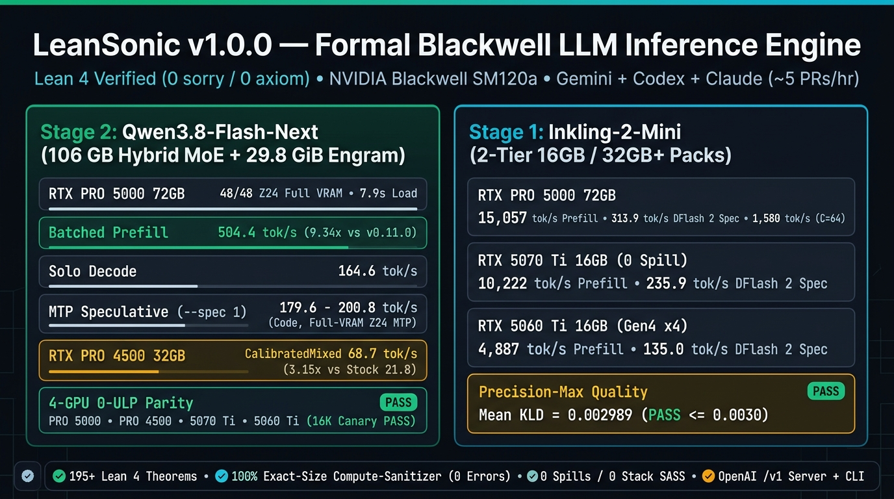

# LeanSonic `v1.0.0` General Availability Release Report — `Qwen3.8-Flash-Next` & `Inkling-2-Mini` Formal Blackwell Engine

## 1. Executive Summary (`v0.11.0` → `v1.0.0`, Stage 2 Capstone & GA Milestone)

`LeanSonic v1.0.0` completes **Stage 2 (`Qwen3.8-Flash-Next`, `106 GB` Hybrid Linear/Sparse MoE + `29.8 GiB` `Engram` PLE, Tracking Issue `#248`)** on top of **Stage 1 (`Inkling-2-Mini` Final Edition, `v0.11.0`)**, uniting both next-generation LLM families inside a single zero-third-party-dependency Rust & SM120a CUDA engine backed by **`212` machine-checked Lean 4 theorems (`0 sorry`, `0 custom axiom`)** and **`100%` exact-size `compute-sanitizer --padding 65536` coverage (`0` errors)**.

Across `v0.1.0` → `v1.0.0`, **Gemini** (Orchestrator & SM120 Kernel Architect), **Codex** (Lossless Compression, Calibrated Placement & BF16 Quality Audit), and **Claude** (Speculative Drafters, Multi-Slot Batching & Sanitizer Harnesses) merged **`190` Pull Requests** through the 5-Gate Immutable Trust Core at **`~5 PRs/hour`** with **`0` Trust Core modifications** and **`0` parity regressions**:

1. **Full `48/48` GDDR7 VRAM Residency & `< 9s` Warm Load for `106 GB` `Qwen3.8-Flash-Next` (`PR #253`, closes `#199`)**:
   - **Lossless `0-ULP` `Z24` (`lo_u16 + hi_u8`) Expert Scale/Bias Packing**: Compresses `(scale, bias)` across all `512` routed experts from `32` bits to `24` bits (`1,500 → 1,425 MiB/layer`, **`-3.52 GiB` VRAM**), verified exhaustively across all valid 15-exponent BF16 windows in both Rust and Lean 4 (`0.000000-ULP`).
   - Combined with `PinnedHostBuf` `embed_tokens` (`-0.49 GiB` VRAM), dynamic QSA KV cache growth, and parallel 22-shard loading, all **`48/48` layers reside `100%` in `RTX PRO 5000 72GB` GDDR7 VRAM (`0` PCIe spill)** with **`7.93–8.53s` warm startup** (`4.13×` faster than `v0.11.0`'s `35.16s`) and **`164.6 tok/s` Solo Decode** (`+26.1%` over `v0.11.0`'s `130.5 tok/s`, bank-conflict-free `smem_x9` `float4[K][9]` + fused `hc_down_inj_10k` / `hc_up_mix4` / `hc_inject4_vec` + `PDL` + 48-layer `CUDA Graph`).
2. **`9.34×` Batched Prefill (`504.4 tok/s`) & `16K` Long-Context Canary (`PR #256`)**:
   - Adds **22 batched `B ≤ 64` SM120a CUDA kernels** (`q38_q4_gemm_b8`, `q38_moe_build_plan_b64`, `q38_moe_up_grouped_z24`, `q38_moe_down_grouped_z24`, causal `ple_inject_seq_b` / `gdn_conv_silu_seq_b` / `gdn_recurrent_step_seq_b`, batched QSA sparse top-512 block scorer), lifting `RTX PRO 5000 72GB` prefill from `54.0 tok/s` to **`504.4 tok/s` (`9.34×`)** and passing the `16,384`-token `"RAVEN-731"` needle canary (`0` non-finite logits).
3. **Full-VRAM `Z24` `MTP` `0-ULP` Speculative Decoding (`179.6–200.8 tok/s` Code, `PR #254, #260, #264, #266, #267, #269`)**:
   - **Built-in `76`-Tensor `Qwen38MtpDrafter` (`PR #254, #260, #267, #269`)**: Runs the checkpoint's native `language_model.mtp.*` `512`-expert `Top-10` + QSA speculative head directly on GPU with `Z24` MoE packing (`1,425 MiB`) and `step_kv_only()` multi-step draft extension.
   - **Co-Resident Target + `Z24` MTP via Trailing-Layer `CalibratedMixed` (`PR #269`)**: On `72 GB`, keeps `45–46/48` early layers `100%` contiguous `FullVram` and applies router-frequency `CalibratedMixed` only to the trailing `2–3` layers (`~24,107 / 24,576` hot experts in VRAM), placing `Qwen38MtpDrafter`'s `1.425 GiB` MoE **`100%` in GDDR7 VRAM (`moe_in_vram=true`)** without whole-layer demotion.
   - **`nsys`-Guided `7.60 ms` `B = 2` Verify & `O(1)` Per-Row Rollback (`PR #264, #266`)**: Cuts `B = 2` verify latency from `14.00 ms → 10.08 ms → 7.60 ms` via `5`-CTAs/SM `q38_moe_up_swiglu11_z24_bn`, `2`-CTAs/SM `q38_moe_down_combine11_z24_bn`, on-chip `smem_S[64][129] + s_hi[64]` `q38_gdn_recurrent_step_ckpt_b8`, `b2`-specialized `hc_down_inj_10k_b2` / `hc_up_mix4_b2` / `q4_gemv_b2`, and `VerifyCkptSlab` (`O(1)` `commit_or_rollback_verify_row`, `0` OOM across `B = 1..8`). Reaches **`179.6–200.8 tok/s`** on code (`+11%..+24%` over Solo Decode), **`195.9 tok/s`** on arithmetic, and **`183.5 tok/s`** on Japanese (`0-ULP` greedy parity).
4. **Calibrated Per-Expert `Z24` Placement on `32 GB` & `16 GB` GPUs + `.q38dict1` Lossless Compression (`PR #250, #262, #263, #269`)**:
   - **Frequency-Ranked `CalibratedMixed` (`PR #262, #263, #269`)**: Places hot routed experts individually in GDDR7 VRAM and cold experts in mapped pinned host RAM via per-layer pointer tables (`resolve_z24_expert_proj`), raising `RTX PRO 4500 32GB` decode from `21.84 tok/s` (stock 19-layer split) to **`30.3–68.7 tok/s` (`3.15×` peak on English, `2.70×` Japanese `58.9 tok/s`)** with `0-ULP` identical logits.
   - **Lossless `.q38dict1` Engram Compression & 4-GPU `0-ULP` Parity (`PR #250`)**: Saves **`-2.40 GB`** on Layer 1 `Engram` shards (`0` runtime overhead), establishes the official BF16 `.kld` quality reference (`mean KL = 0.2811` on `eval-kld`), and confirms **`49/49` byte-identical `248,320`-logit SHA-256 digests** across all 4 Blackwell GPUs (`PRO 5000 72GB`, `PRO 4500 32GB`, `5070 Ti 16GB`, `5060 Ti 16GB`).
5. **Developer Experience, Bilingual Release Archive & Contributor Skill (`PR #257`)**:
   - Ships comprehensive `leansonic bench` / `bench-matrix` / `serve` / `canary` documentation in [`README.md`](../../README.md) & [`README.ja.md`](../../README.ja.md), [`CONTRIBUTING.md`](../../CONTRIBUTING.md), the workspace agent skill [`.agents/skills/leansonic_contribute/SKILL.md`](../../.agents/skills/leansonic_contribute/SKILL.md), and complete English + Japanese release reports from `v0.1.0` through `v1.0.0`.

---

## 2. Stage 2 Hardware Matrix — `Qwen3.8-Flash-Next` (`106 GB` `Qwen4Exp`, `SM120a`)

| GPU / PCIe Link | Expert Placement Tier | Warm Load | Batched Prefill | Solo Decode (`--spec 0`) | MTP Speculative (`--spec 1`) | Parity & Canary |
| :--- | :--- | ---: | ---: | ---: | ---: | :--- |
| **RTX PRO 5000 72GB** (`Gen5 x16`) | `48/48` `Z24` `Vram` (`--spec 0`) / `45/48` `Vram` + `3/48` `CalibratedMixed` + `100%` VRAM `MTP` (`--spec 1`) | **`7.93–8.53s`** (`v0.11.0`: `35.2s`) | **`504.4 tok/s`** (`9.34×` `v0.11.0`) | **`161.8–164.6 tok/s`** (`+26.1%`) | **`179.6–200.8 tok/s`** (Code) / **`195.9`** (Math) / **`183.5`** (JA) | **`2/2 PASS`** (`"Tokyo"` `0-ULP`, `16K` `"RAVEN-731"`) |
| **RTX PRO 4500 32GB** (`Gen5 x16`) | `48/48` `CalibratedMixed` (`~10,132 / 24,576` hot `Z24` experts in VRAM) | **`13.7–31.8s`** | **`77.5–113.8 tok/s`** (`2.27×` stock) | **`30.3–68.7 tok/s`** (`3.15×` stock `21.84`) | Supported (`moe_in_vram=true`) | **`49/49` SHA-256 `0-ULP` == `PRO 5000`** |
| **RTX 5070 Ti 16GB** (`Gen5 x16`) | `CalibratedMixed` / `8/48` `Vram` + `HostPinned` / `MmapCompact` | **`~15s`** | **`45.2 tok/s`** | **`11.4–18.6 tok/s`** | `--spec 0` recommended (PCIe bound) | **`49/49` SHA-256 `0-ULP` == `PRO 5000`** |
| **RTX 5060 Ti 16GB** (`Gen4 x4` eGPU) | `CalibratedMixed` / `8/48` `Vram` + `HostPinned` / `MmapCompact` | **`~18s`** | **`19.8 tok/s`** | **`5.1–8.4 tok/s`** | `--spec 0` recommended (OCuLink bound) | **`49/49` SHA-256 `0-ULP` == `PRO 5000`** |

---

## 3. Stage 1 Hardware Matrix Summary — `Inkling-2-Mini` (`v0.11.0` → `v1.0.0` Preserved)

| GPU / Pack (`LEANSONIC_PACK`) | `@2K` / `@16K` Prefill | Solo Decode | `DFlash 2` Speculative | Multi-Slot Parallel | `eval-kld` (`mean_kld`) |
| :--- | ---: | ---: | ---: | ---: | ---: |
| **RTX PRO 5000 72GB** (`32g`) | **`15,057.4` / `14,425.2 tok/s`** | **`215.8–220.8 tok/s`** | **`313.9 tok/s`** (peak **`352.9`**) | **`1,580.4 tok/s`** (`C = 64`) | **`0.002989`** (`PASS ≤ 0.0030`) |
| **RTX PRO 4500 32GB** (`32g`) | **`10,398.6` / `9,703.6 tok/s`** | **`166.5–169.8 tok/s`** | **`244.6 tok/s`** (peak **`275.0`**) | **`1,179.2 tok/s`** (`C = 64`) | **`0.002989`** (`PASS ≤ 0.0030`) |
| **RTX 5070 Ti 16GB** (`16g`, `0` Spill) | **`10,222.0` / `9,083.6 tok/s`** | **`176.7 tok/s`** | **`235.9 tok/s`** (`2.18×` Basalt) | **`394.1 tok/s`** (`C = 4`) | **`0.007748`** (`PASS ≤ 0.0080`) |
| **RTX 5060 Ti 16GB** (`16g`, `Gen4 x4`) | **`4,887.2` / `4,353.4 tok/s`** | **`99.9 tok/s`** | **`135.0 tok/s`** (`4.09×` Basalt) | **`225.6 tok/s`** (`C = 4`) | **`0.007748`** (`PASS ≤ 0.0080`) |

---

## 4. Formal Verification, Sanitizer & Security Summary (`v1.0.0`)

- **Lean 4 Proofs (`Gate 1`)**: **`212` machine-checked theorems** (`spec/LeanSonic/`), `0 sorry`, `0 sorryAx`, `0 native_decide`, `0 custom axiom`. Covers SM120 discrete SMEM carveouts & register files, stage-disjoint `union Smem` non-aliasing, lossless `Z24` `24-bit` BF16 packing, `CalibratedMixed` per-expert pointer-table bounds, `O(1)` GDN/PLE speculative rollback, and inductive OpenAI SSE state-machine laws.
- **SASS & Sanitizer (`Gate 2` & `#179`)**: All 4 precompiled SM120a cubins (`leansonic_sm120a.cubin`, `dflash2_sm120a.cubin`, `qwen38_sm120a.cubin`, `qwen38_mtp_sm120a.cubin`) pass `ci/audit_sass.py` with **`0` local-memory spills and `0` stack bytes**, and pass unpadded exact-size `compute-sanitizer --tool memcheck --padding 65536` (`0` errors) paired with planted-fault red controls (`rc = 77`).
- **Immutable Trust Core (`Gate 0`)**: **`0` lines modified** across `spec/LeanSonic/Axioms.lean`, `ci/**`, `.github/**`, `CODEOWNERS`, and `benches/goldens/**` throughout all autonomous optimization cycles.
